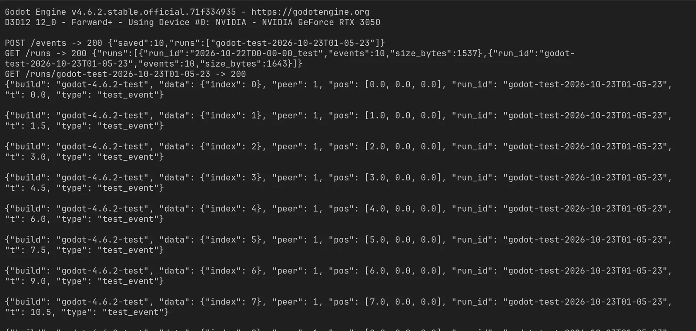
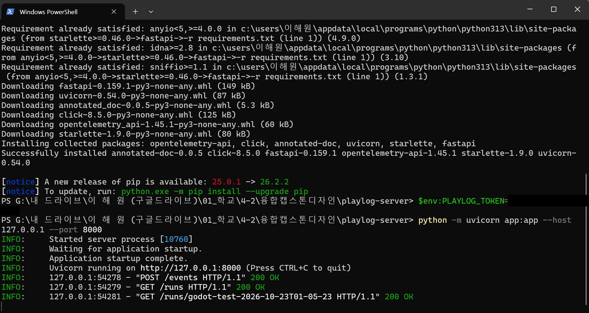

## 목표

게임과 무관하게 단독으로 돌아가면서, 게임이 보내는 사건 기록을 받아 run_id별로 저장하고, 조회·다운로드까지 되는 서버를 만든다.

## 진행 과정

### A. 엔드포인트 설계

- FastAPI로 엔드포인트 세 개를 만들고, 모든 요청에 `X-Token` 헤더 검사를 넣음 (인증은 B)
  - FastAPI: 파이썬으로 웹 API 서버를 빠르게 만드는 프레임워크
  - 엔드포인트: 서버가 요청을 받는 주소 하나하나
  - `POST /events`: JSON 배열로 받은 이벤트를 `run_id`별로 묶어 `data/<run_id>.jsonl`에 한 줄씩 추가 저장
  - `GET /runs`: 저장된 run_id 목록, 이벤트 수, 파일 크기를 반환
  - `GET /runs/<run_id>`: 해당 run 파일을 그대로 다운로드
- JSON Lines(.jsonl)로 저장하는 이유: 기록이 계속 쌓여도 파일 뒤에 한 줄씩 붙이기만 하면 됨
  - JSON Lines: 한 줄에 이벤트 하나씩 적는 형식. 파일 하나에 큰 배열 하나를 담는 일반 JSON과 다름

### B. 토큰 인증 검사

- 요청 헤더 `X-Token` 값이 환경변수 `PLAYLOG_TOKEN`과 다르면 401로 거절
  - 환경변수: 코드에 적지 않고 실행 환경에 따로 저장해두는 값. 토큰 같은 비밀값을 코드에 박아두지 않으려고 씀
  - 401: "인증 안 됨"을 뜻하는 HTTP 상태 코드
- `run_id`에 `/`나 `..`가 들어가면 거부. `run_id`를 그대로 파일 경로에 쓰기 때문
  - 경로 조작(path traversal): 파일 경로에 `..`을 넣어 원래 폴더 밖의 파일에 접근하는 공격 수법

### C. 로컬 테스트

- 서버를 로컬에 띄우고 직접 요청을 보내 확인함
  - 토큰 없이 POST: `401 invalid or missing X-Token`
  - 토큰 포함, 이벤트 10개 POST: `{"saved": 10, "runs": ["2026-10-22T00-00-00_test"]}`
  - `GET /runs`: `{"runs": [{"run_id": "2026-10-22T00-00-00_test", "events": 10, "size_bytes": 1537}]}`
  - `GET /runs/2026-10-22T00-00-00_test`: 10줄 JSON Lines가 원본 그대로 다운로드됨
- Godot 4.6.2 빈 프로젝트(`playlog-test`)에서 HTTPRequest로 이벤트 10개를 보내 확인함 (윈도우 데스크톱, 2026-10-23)
  - `POST /events`: `200 {"saved":10,"runs":["godot-test-2026-10-23T01-05-23"]}`
  - `GET /runs`: 해당 run이 `"events":10`으로 집계됨
  - `GET /runs/godot-test-2026-10-23T01-05-23`: 보낸 10줄이 그대로 내려받아짐

    

  - 서버 창에도 요청 3개 모두 `200 OK`
  - HTTPRequest: Godot에서 HTTP 요청을 보내는 노드
- 보낸 스크립트는 저장소의 `godot_test.gd`로 남김

### D. 저장소 정리

- README에 실행 방법(맥/윈도우), 토큰 전달 방법, API, 내려받은 파일 예시, 검증 기록, 인수인계 절차를 정리함
  - README: 저장소 첫 화면에 보이는 설명 문서
- Godot 검증에 쓴 스크립트를 `godot_test.gd`로 저장소에 넣음. 기획자가 같은 테스트를 다시 돌릴 수 있게
- `git add` → `git commit` → `git push`로 GitHub에 올림 (Private 저장소)
  - commit: 고른 변경을 메시지와 함께 한 번의 기록으로 저장
  - push: 내 PC의 기록을 GitHub로 올리기
  - 테스트로 쌓인 `.jsonl` 기록은 `.gitignore`로 빼서 안 올라감
- 외부 서비스 없이 PC + 포트 방식이라 계정 이전은 없음. 저장소는 팀장이 원하면 그쪽 계정으로 이전

## 남은 작업

- 팀장 GitHub 아이디 받아서 저장소 초대 (원하면 저장소 이전)
