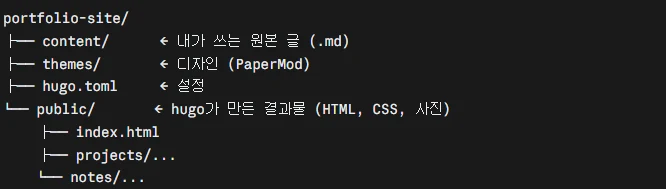

### A. Nginx 컨테이너로 테스트 페이지 띄우기
- 실제 사이트 만들기 전 웹 서버 컨테이너가 동작하는 지 확인
    - 웹 서버 : 브라우저가 페이지 요청하면 파일 보내주는 프로그램
        - <mark>Nginx : 제일 많이 쓰는 웹 서버, 이미지 이름</mark>
            - <mark>VM에 없으면 Docker Hub에서 자동으로 받아옴</mark>
                - 2단계 hello-world랑 같은 원리
                - <mark>vm에는 따로 설치 안 함. 컨테이너 안에만 있음</mark>
- 테스트 페이지 작성

    ```bash
    mkdir -p ~/site && echo '<h1>Hello from homelab</h1>' > ~/site/index.html
    ```

    - mkdir -p ~/site : home 폴더에 site 폴더 만들기 , -p는 이미 있어도 에러 안 내는 코드
    - <mark>&gt; : 출력한 걸 파일에 저장</mark>
- Nginx 컨테이너 실행

    ```bash
    docker run -d --name site -p 80:80 -v ~/site:/usr/share/nginx/html:ro --restart unless-stopped nginx
    ```

    - <mark>-d : 백그라운드 실행</mark>
    - --name site : 컨테이너 이름 지정
    - <mark>-p 80:80 ⇒ vm 80번 포트를 컨테이너 80 포트에 연결</mark>
        - 80번은 웹사이트 기본 창구.
        - VM과 컨테이너 연결시켜주는 선이 -p
    - -v ~~ : VM의 ~~ 폴더를 Nginx 기본 웹 폴더에 연결.
        - -v 왼쪽 : vm 폴더, 오른쪽 : 컨테이너 폴더
        - VM에서 파일만 바꾸면 컨테이너에 바로 반영.
    - ro  : 읽기 전용
    - --restart unless-stopped : VM이 재부팅되도 자동으로 Nginx 재실행. 직접 멈춘 경우 제외
- 접속 확인
    - http://`<Tailscale IP>`
        - <mark>s 없음 : 암호화 안 된 연결 (아직 인증서가 없음)</mark>
        - 포트 안 쓴 이유 : 80 기본이라
        - 접근 범위 : 외부 X / Tailscale 등록기기 및 집 WIFI 접속 가능

### B. Hugo 사이트 구성과 GitHub 업로드
- 큰 흐름 : 글 (.md) → Hugo 변환 → public/ → Nginx가 보여줌 → 브라우저
- Hugo : 마크다운을 디자인, 메뉴가 붙은 HTML 사이트로 만들어주는 프로그램
    - hugo 만 칠 때 돌아감
    - 정적 사이트 생성기 : HTML을 미리 다 만들어둠 (DB, 서버 코드가 필요 없음)
    - 선택 이유 : 노션 글을 마크다운 형식으로 내보내 그대로 옮길 수 있어서 선택
    - AWS 실습과 다른 점
        - EC2에 Nginx 직접 깔아서 같은 역할로 사용
    - Nginx VS Hugo (헷갈렸던 점)
        - Hugo는 만드는 쪽(주방) / Nginx는 보내주는 쪽 (계산대)

    

    - <mark>public/ : Hugo 가 만든 완성품이 담기는 폴더</mark>
        - 그래서 nginx 컨테이너가 ~/portfolio-site/public 을 가리킴
- Hugo 설치

    ```bash
    sudo snap install hugo
    hugo version
    ```

    - snap : 우분투 앱 설치 도구
- 사이트 생성 및 테마

    ```bash
    hugo new site ~/portfolio-site && cd ~/portfolio-site
    git init
    git submodule add --depth=1 https://github.com/adityatelange/hugo-PaperMod.git themes/PaperMod
    ```

    - hugo new site : 사이트 뼈대 폴더 생성
        - 글은 content/, 설정은 hugo.toml
    - hugo.toml : Hugo 사이트 설정 파일 (핵심 줄)

        ```toml
        baseURL = "https://ihaewon.com/"
        title = "이해원 | Cloud Infra Portfolio"
        theme = "PaperMod"
        ```

        - baseURL : 사이트 주소. 링크를 만들 때 기준이 됨 (4단계에서 도메인 사고 바꿈)
        - title : 브라우저 탭 제목
        - theme : 쓸 테마. themes/ 폴더 안 이름이랑 같아야 함
    - git init
        - 이 폴더를 git이 관리하게 시작
    - 테마 (paperMod) : 디자인 묶음
        - css 직접 안 짜고 디자인 입힘
    - git submodule : 테마 코드를 복사하지 않고 원본 저장소 주소만 걸어둠
- 빌드 및 반영

    ```bash
    hugo
    docker rm -f site
    docker run -d --name site -p 80:80 -v ~/portfolio-site/public:/usr/share/nginx/html:ro --restart unless-stopped nginx
    ```

    - hugo : public/ 에 완성된 사이트 만들기 —> 빌드
    - docker rm -f : A의 테스트 컨테이너 강제 삭제
    - A랑 같은 명령에 연결 폴더만 변경 (~/site —> ~/portfolio-site/public)
    - 이후에 글 고치고 hugo 만 치면 끝
        - nginx가 public/ 을 계속 보고 있어서 컨테이너 재시작 필요 X
- GitHub 업로드
    - 목적 : 원본을 VM 밖에 보관. VM이 망가져도 추후 복구 가능.
    - .gitignore : 안 올릴 파일 목록

        ```
        public/
        resources/_gen/
        .hugo_build.lock
        infra/monitoring/prometheus/targets.local.yml
        ```

        - public/ 은 hugo로 언제든 다시 만들 수 있어서 안 올렸다
        - resources/_gen/, .hugo_build.lock : hugo가 빌드할 때 만드는 임시 파일
        - targets.local.yml : 실제 IP 파일. 7단계에서 추가함
- Deploy Key ( VM 키 발급)

    ```bash
    ssh-keygen -t ed25519 -C "portfolio-vm" -f ~/.ssh/id_ed25519 -N ""
    cat ~/.ssh/id_ed25519.pub
    ```

    - Deploy Key : VM에서 GitHub로 나가는 열쇠
        - 열쇠 : 개인키가 있는 쪽 → 공개키를 걸어둔 쪽 으로만 열림.
        - 사용 이유 : 이 저장소 하나에만 열림. VM이 뚫려도 다른 저장소는 안전함
    - 코드
        - -C : 열쇠 이름표
        - -f : 저장위치 지정
        - -N “” : 비밀번호 없이 → 질문 안 나오게 미리 답함
    - 공개키를 github 저장소 setting에 deploy key 등록.
        - 쓰기 권한 허용
    - cat … pub : 공개키 내용을 화면에 출력 → 이걸 복사해서 GitHub에 등록
    - 확인

        ```bash
        ssh -T git@github.com 
        ```

        - successfully authenticated 뜨면 성공
- 업로드

    ```bash
    git add .
    git commit -m "Hugo 포트폴리오 사이트 초기 구성"
    git branch -M main
    git remote add origin git@github.com:GODnjs1007/portfolio-site.git
    git push -u origin main
    ```

    - add : 올릴 파일 담기
    - commit : 메모와 함께 저장
    - git branch -M main : 기본 브랜치 이름 main으로 설정
    - remote add origin : 올릴 주소 등록
    - push -u : 올리기 , 다음 부터는 git push 만

### 트러블슈팅
- hugo --minify 빌드 실패
    - 원인 : Hugo 최신 버전과 테마 호환 문제
    - 해결 : --minify 빼고 hugo로 빌드
- ssh-keygen 키 저장 실패
    - 원인 : 질문 칸에 다음 명령어까지 같이 붙여넣어짐
    - 해결 : -f, -N 옵션으로 질문 안 나오게 미리 답함
- VM에서 hugo 빌드 실패
    - 원인 : 작업 환경(0.167)과 VM(0.165) Hugo 버전 차이
    - 해결 : 0.165에서 되는 문법으로 수정. 배포 전 hugo version 확인
- 명령어를 엉뚱한 터미널에서 실행
    - 원인 : 윈도우 명령을 VM에, VM 명령을 윈도우에 입력
    - 해결 : 치기 전에 프롬프트(PS C: / `<사용자>@portfolio`) 먼저 보기
- 데스크톱에서 VM SSH 접속 timeout
    - 원인 : 데스크톱에 Tailscale이 없음
    - 해결 : Tailscale 설치 → 데스크톱 키 만들고 맥북으로 접속해서 authorized_keys에 추가
