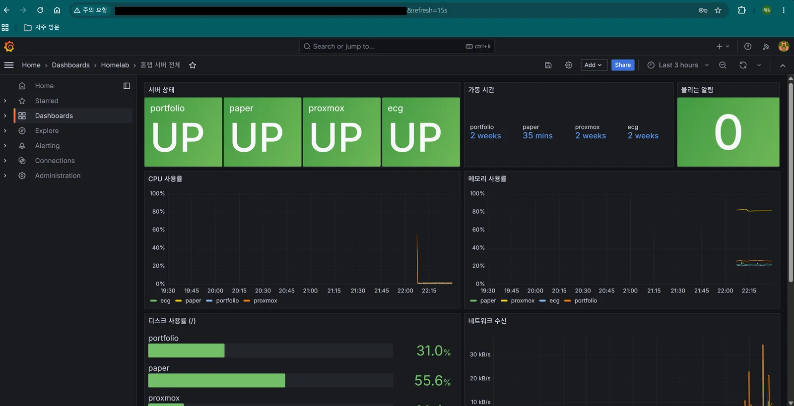
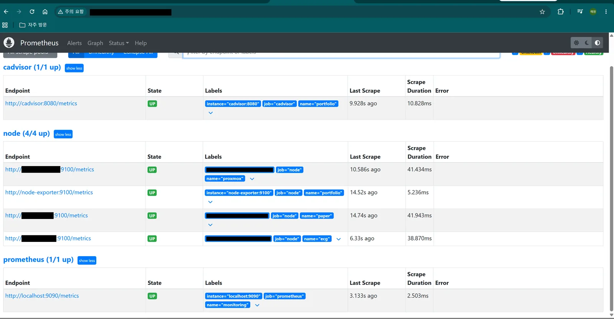
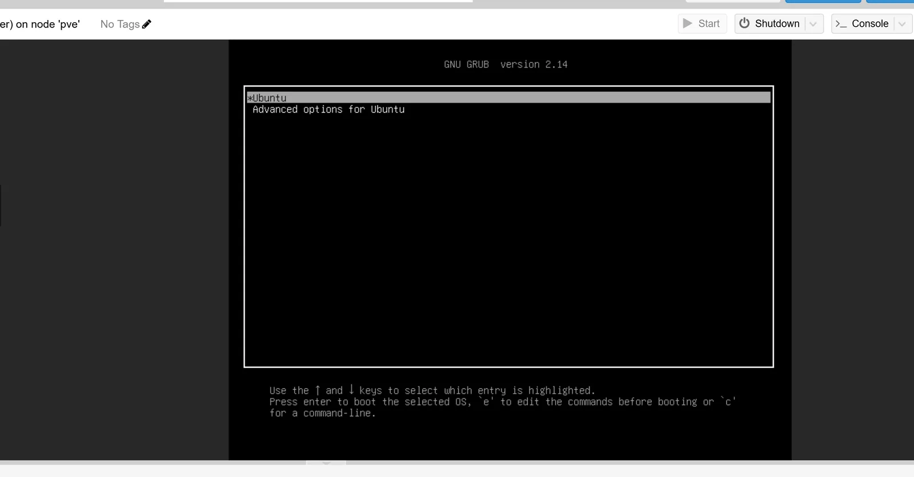
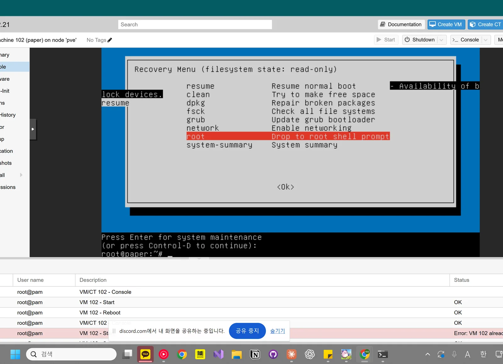
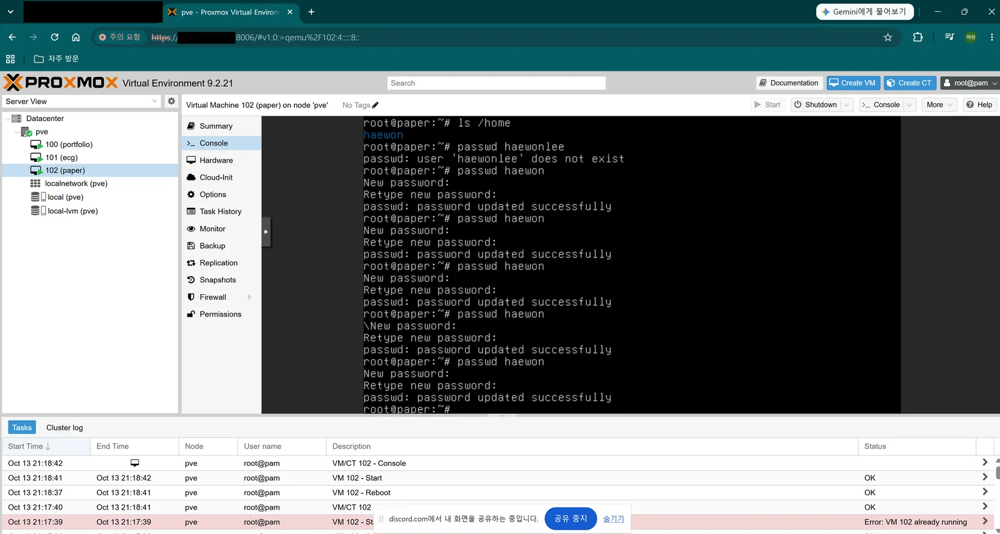

## 목표

홈랩 서버 4대(Proxmox 호스트, portfolio, ecg, paper)의 상태를 한 화면에서 본다. 산학 서버에 Prometheus·Grafana를 붙여본 경험을 홈랩 전체로 넓혔고, 서버가 죽거나 디스크·메모리가 차면 알 수 있게 알림 규칙까지 넣는다. (10.13)

- 5·6단계(k3s, 자동 배포)보다 먼저 함. 산학에서 막 해봐서 손에 익었을 때 바로 하려고

## 구성

```plain text
portfolio VM (항상 켜둠)
 └ Prometheus(:9090) + Grafana(:3000) + node-exporter + cAdvisor
      ↑ 15초마다 수집 (Tailscale)
 ┌────┼─────────┬─────────┐
portfolio  paper     ecg      proxmox
node-exp   node-exp  node-exp node-exp
```

- 중앙 한 곳에서 전부 봄. 다른 서버는 node-exporter(숫자를 내보내는 체온계)만 설치
- 중앙을 portfolio에 둔 이유: 항상 켜져 있는 서버. ecg는 산학 기업 장비가 오면 끌 예정
- paper는 메모리가 적어서 가벼운 node-exporter만 올림
- 설정 파일은 포트폴리오 사이트 저장소 `infra/monitoring/`에 둠. 포트폴리오 VM에 이미 받아져 있어서 `git pull` 한 번으로 배포
- 산학에서 겪은 Docker 29 cAdvisor 문제(컨테이너 지표 누락) 우회 설정을 처음부터 넣음

## 진행 과정

### A. 각 서버에 node-exporter 설치 (paper, ecg, pve)

```bash
sudo apt update && sudo apt install -y prometheus-node-exporter
curl -s localhost:9100/metrics | head -3     # # HELP ... 가 나오면 성공
```

- ecg에는 산학용 node-exporter가 이미 있지만 도커 안에서만 보여서, 홈랩용을 서버에 따로 설치. 산학 설정은 안 건드림
- pve는 root라 `sudo` 없이. Proxmox 웹 → pve → Shell

### B. portfolio에 중앙 띄우기

```bash
cd ~/portfolio-site && git pull
cd infra/monitoring
GRAFANA_PASSWORD=... docker compose up -d
```

### C. 확인

- `http://<Tailscale IP>:9090/targets`: node 4개, cAdvisor, Prometheus 전부 UP
- 캡처: targets 화면
- `http://<Tailscale IP>:3000` → Dashboards → Homelab → 홈랩 서버 전체
- 캡처: 대시보드




### D. 대시보드와 알림 규칙

| 패널 | 보는 것 |
| --- | --- |
| 서버 상태 | 서버별 UP / DOWN |
| 가동 시간 | 마지막 재부팅 후 시간 |
| 울리는 알림 | 지금 켜진 알림 수 |
| CPU · 메모리 · 디스크 · 네트워크 | 서버별 사용률 |
| portfolio 컨테이너 | 사이트 Nginx 등 컨테이너별 CPU·메모리 |

| 알림 | 조건 |
| --- | --- |
| 서버다운 | 응답 없음 2분 이상 |
| 디스크부족 | 85% 초과 5분 |
| 메모리부족 | 90% 초과 5분 |
| CPU과부하 | 90% 초과 10분 |

- 지금은 Prometheus 화면(`:9090/alerts`)에서 확인만. 메일·메신저 전송은 다음 단계

## 결과 (10.13 밤)

- 4대 모두 UP, 울리는 알림 0
- 디스크: portfolio 31.0%, paper 55.6%
- proxmox 호스트 메모리가 약 80%로 가장 높음. VM 3대에 4 + 6 + 1GB를 나눠주고 있어서. VM을 더 늘리면 먼저 볼 숫자

## 트러블슈팅

### paper VM 로그인 실패

- 증상: SSH와 Proxmox 콘솔 모두 "Login incorrect"
- 확인: 다른 접속 수단이 없었음. paper에는 SSH 키를 등록하지 않았음
- 해결: Proxmox 콘솔에서 재부팅 → GRUB 메뉴(Esc) → Advanced options → recovery mode → root 셸

```bash
mount -o remount,rw /     # 복구 모드는 읽기 전용이라 쓰기 가능하게
ls /home                  # 실제 계정 이름 확인
passwd <계정>
sync && reboot
```

- 원인: `ls /home`으로 보니 paper 계정 이름이 다른 VM(<사용자>)과 달랐음. 계정 이름이 틀려도 "비번 틀림"과 같은 메시지가 나와서 비번 문제로 착각함
- 캡처: GRUB 메뉴, Recovery Menu, `ls /home` 결과





### 복구 모드에서 Proxmox 재부팅 버튼이 안 먹힘

- 증상: Reboot 작업이 계속 돌다가 `VM quit/powerdown failed`, 두 번 누르면 `can't lock file`
- 원인: Proxmox 버튼은 VM에 전원 버튼 신호(ACPI)를 보내는데, 복구 모드는 그 신호를 처리하는 서비스가 안 떠 있음. 첫 작업이 끝나기 전에 또 누르면 VM 설정 파일이 잠겨 있어서 실패
- 해결: 콘솔에서 직접 `sync` → `reboot`

### Grafana 비번을 모름

- 증상: 산학·홈랩 Grafana 두 곳 다 비번이 기억 안 남
- 원인: `GRAFANA_PASSWORD=` 뒤에 넣을 자리 표시 글자를 그대로 복사해서 실행함. 비번이 그 글자 자체가 됨
- "비번 찾기"는 메일 서버 설정이 없어서 동작 안 함
- 해결: 서버에서 관리자 비번 강제 재설정

```bash
sudo docker exec <grafana 컨테이너> grafana cli admin reset-admin-password <새 비번>
```

- 참고: `GRAFANA_PASSWORD`는 Grafana를 처음 켤 때만 쓰임. 나중에 값을 바꿔 다시 띄워도 비번은 안 바뀜

### 재발 방지

- [ ] paper에 맥·데스크톱 SSH 키 등록 (비번 없이도 들어갈 수단 확보)
- [ ] 서버별 계정 이름·비번을 비번 관리 앱에 정리
- [ ] 명령어 복사 전 `<...>`·예시 값이 있는지 확인

## 남은 작업

- [ ] Grafana 비번 재설정 (산학 ecg, 홈랩 portfolio)
- [ ] 알림을 메일이나 메신저로 보내기 (Alertmanager)
- [ ] ecg 종료 후 수집 대상에서 빼기 (`targets.yml` 한 줄 삭제)
