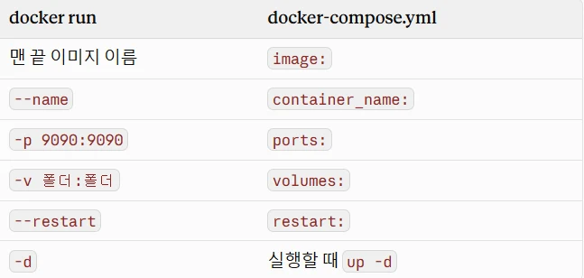

### A. 구성 설계
- 모니터링 : 서버 상태를(CPU, memory, disk, network 사용) 계속 재서 문제를 사람보다 먼저 알아채는 것
- 구조 : 중앙 (prometheus + Grafana) 한 곳 + 각 서버엔 node-exporter 만
    - node-exporter : 서버 상태를 숫자목록으로 내보내는 프로그램
        - 기본 포트 9100
    - Prometheus : 15초마다 node-exporter을 읽고(수집) , 시간순으로 저장하는 프로그램
        - 기본 포트 : 9090
    - Grafana : 기록을(prometheus에 저장된 숫자) 그래프,대시보드로 보여주는 프로그램
        - 기본 포트 : 3000
    - cAdvisor : 컨테이너별 서버 상태 사용량을 내보내는 프로그램
- 흐름 : node-exporter/cAdvisor이 숫자 줌 → Prometheus가 15초마다 가져가 저장 → Grafana가 그래프로 표시
- 중앙을 portfolio로 설정
    - 항상 켜져있는 서버
    - ecg VM은 추후 끌 예정
    - paper VM은 node-exporter만 설정
        - 메모리 1GB라 가벼운 것만
- 설정 파일은 infra/monitoring/ 에 둠
    - VM에서 git pull 로 한 번에 배포
        - 3단계 사이트 배포랑 같은 흐름

### B. 각 서버에 node-exporter 설치
- 공통 명령어 (apt로 설치하는 서버)

    ```bash
    sudo apt update && sudo apt install -y prometheus-node-exporter
    curl -s localhost:9100/metrics | head -3
    ```

    - 9100 : node-exporter 기본 포트
    - curl … | head -3 : 숫자 목록 앞 3줄만 보기 —> #HELP … 나오면 성공
- portfolio VM —> Prometheus 가 있는 서버
    - 별도 설치 X
        - node-exporter도 컨테이너로 Prometheus 옆에 같이 띄움
- pve (Proxmox 호스트, VM 아님)
    - root 라 sudo 없이 설치 (proxmox 웹 → pve → shell)
- paper VM (SSH 접속 후)
    - 위 명령어로 node-exporter 설치
- ecg VM (SSH 접속 후 )
    - 산학용 node-exporter가 도커 안에만 있어서, 홈랩용 서버에 따로 설치
        - node-exporter : 컨테이너 —> 산학 도커 네트워크 안에서만 보임
        - VM에 apt로 설치해서 9100 열어줌

### C. portfolio에 중앙 띄우기
```bash
cd ~/portfolio-site && git pull
cd infra/monitoring
GRAFANA_PASSWORD=새비번 docker compose up -d
```

!monitoring_tree.png

- 파일 연결 흐름 (이 순서대로 아래에 설명)

    ```
    1. docker-compose.yml : 컨테이너 4개 띄움
    ├─ prometheus 컨테이너  ← prometheus/ 폴더 연결
    │    └─ 2. prometheus.yml : 얼마마다, 어디서 수집할지
    │         ├─ 3. targets.local.yml : 수집할 서버 4대 주소
    │         └─ alerts.yml : 알림 규칙 (→ D)
    ├─ grafana 컨테이너  ← grafana/ 폴더 연결
    │    └─ 4. provisioning/ 파일 2개 : 켜질 때 Prometheus 연결 + 대시보드 불러오기
    ├─ node-exporter : portfolio VM 상태
    └─ cadvisor : portfolio 컨테이너별 상태
    ```

- 코드 이해
    - <mark>docker compose : 여러 컨테이너를 설정 파일 하나로 한 번에 띄우고 관리하는 도구 (설정파일 이름 : docker-compose.yml)</mark>
        - 3단계는 docker run으로 하나씩 띄움
            - 이번엔 4개 (prometheus, Grafana, node-exporter, cAdvisor)라 compose 사용
        - up -d : 파일에 적힌 컨테이너 전부 켜기 + 백그라운드
    - GRAFANA_PASSWORD :  Grafana 관리자 비밀번호, 처음 켤 때만 씀
1. docker-compose.yml : docker run 옵션을 파일에 칸별로 옮겨 적은 것

    

    - 위치 : portfolio-site/infra/monitoring/docker-compose.yml
    - 구성 : services 밑에 컨테이너 4개 : prometheus, grafana, node-exporter, cAdvisor , 맨 아래 volumes
        - prometheus

            ```yaml
            services:
              prometheus:
                image: prom/prometheus:v2.54.1
                container_name: hl-prometheus
                command:
                  - --config.file=/etc/prometheus/prometheus.yml
                  - --storage.tsdb.retention.time=30d
                volumes:
                  - ./prometheus:/etc/prometheus:ro
                  - prometheus-data:/prometheus
                ports:
                  - "9090:9090"
                restart: unless-stopped
            ```

            - services : 이 아래 띄울 컨테이너 적는 시작 표시
            - command : 컨테이너 켤 때 프로그램에 넘기는 옵션
                - --config.file : 설정 파일 위치
                - --storage.tsdb.retention.time=30d : 수집한 숫자 30일만 보관
            - ./prometheus:/etc/prometheus:ro : VM의 설정 폴더를 읽기 전용으로 연결
            - prometheus-data:/prometheus : 수집한 데이터 도커 볼륨에 저장
            - port 9090:9090 : VM 9090 → 컨테이너 9090에 연결
        - Grafana

            ```yaml
            grafana:
              image: grafana/grafana:11.2.0
              container_name: hl-grafana
              environment:
                GF_SECURITY_ADMIN_PASSWORD: "${GRAFANA_PASSWORD:?GRAFANA_PASSWORD를 지정하세요}"
                GF_USERS_ALLOW_SIGN_UP: "false"
              volumes:
                - ./grafana/provisioning:/etc/grafana/provisioning:ro
                - ./grafana/dashboards:/var/lib/grafana/dashboards:ro
                - grafana-data:/var/lib/grafana
              ports:
                - "3000:3000"
              depends_on: [prometheus]
              restart: unless-stopped
            ```

            - environment : 컨테이너 안에 넣는 설정 값 (환경변수)
                - GF_SECURITY_ADMIN_PASSWORD : 관리자 비번
                - ${GRAFANA_PASSWORD:?} : 실행할 때 넘긴 값을 넣음. 값이 없으면 에러 내고 멈춤
                - GF_USERS_ALLOW_SIGN_UP: "false" : 다른 사람 회원가입 막기
            - provisioning : 켜질 때 데이터 출처(prometheus)를 자동 설정 (아래 4번)
            - dashboards : 미리 만든 홈랩 서버 전체 대시보드를 자동으로 불러옴
            - grafana-data : Grafana 설정 , 비번을 볼륨에 저장
            - depends_on : prometheus가 먼저 켜진 후 Grafana 켬
        - node-exporter

            ```yaml
            node-exporter:
              image: prom/node-exporter:v1.8.2
              container_name: hl-node-exporter
              command: ["--path.rootfs=/host"]
              pid: host
              volumes:
                - /:/host:ro,rslave
              restart: unless-stopped
            ```

            - 컨테이너는 원래 VM 정보를 보지 못 함 → 마지막 세 줄로 볼 수 있게 함
                - volumes /:/host:ro : VM 전체 (/)를 컨테이너 안 /host에 읽기 전용으로 연결 (3단계 -v랑 같은 원리)
                - --path.rootfs=/host : VM 정보는 /host에서 읽으라고 지정
                - pid: host : VM의 프로세스 목록을 볼 수 있게 함
                - rslave : VM에 나중에 붙는 디스크도 따라 보이게 하는 옵션
                - ports 없음 : 밖으로 안 열어도 됨.
                    - Prometheus가 같은 네트워크 안에서 node-exporter:9100으로 찾아옴
            - portfolio VM에는 별도 설치 X
                - docker-compose.yml에 컨테이너로 들어 있기 때문
                - ecg, paper, pve 만 별도 설치
        - cAdvisor

            ```yaml
            cadvisor:
              image: gcr.io/cadvisor/cadvisor:v0.49.1
              container_name: hl-cadvisor
              privileged: true
              devices: ["/dev/kmsg"]
              volumes:
                - /sys:/sys:ro
                - /dev/disk/:/dev/disk:ro
              restart: unless-stopped
            ```

            - privileged true : 컨테이너 관리자급 권한.
                - 다른 컨테이너 사용량을 읽으려면 필요
            - device : [”/dev/kmsg”] : 커널 메세지 읽기
            - /sys:/sys:ro : 리눅스가 컨테이너별 CPU, 메모리, 사용량을 기록하는 곳
            - /dev/disk : 디스크 연결 정보
        - volumes

            ```yaml
            volumes:
              prometheus-data:
              grafana-data:
            ```

            - 도커 볼륨 : 도커가 관리하는 저장 공간, 컨테이너를 지워도 데이터 유지
                - bind mount (-v폴더: 폴더) : 내 VM 폴더 연결
                - 볼륨 : 도커가 만든 공간
                - Grafana 비번이 처음 한 번 적용되는 이유 : 첫 비번이 grafana-data에 저장
            - 같은 compose로 띄운 컨테이너는 같은 도커 네트워크 —> 서비스 이름으로 서로 찾음
2. prometheus/prometheus.yml
    - 얼마마다, 어디서 수집하고 어떤 알림 규칙 적용할지 정하는 파일

    ```yaml
    global:
      scrape_interval: 15s
      evaluation_interval: 15s
    rule_files:
      - /etc/prometheus/alerts.yml
    scrape_configs:
      - job_name: prometheus
        static_configs: [{ targets: ["localhost:9090"], labels: { name: monitoring } }]
      - job_name: node
        file_sd_configs:
          - files: [/etc/prometheus/targets.local.yml]
            refresh_interval: 30s
      - job_name: cadvisor
        static_configs: [{ targets: ["cadvisor:8080"], labels: { name: portfolio } }]
    ```

    - scrape_interval 15s : 15초마다 수집
    - evaluation_interval 15s : 15초마다 알림 규칙 검사
    - rule_files : 알림 규칙 파일 위치 (alerts.yml → D)
    - scrape_configs : 수집 대상 묶음(job) 3개
        - prometheus : 자기 자신 상태
        - node : 서버 4대. 대상은 targets.local.yml에서 읽음 (file_sd_configs)
        - cadvisor : portfolio 컨테이너들
    - refresh_interval 30s : targets.local.yml을 30초마다 다시 읽음 → 서버 추가해도 재시작 없이 반영
    - 연결 정리 : docker-compose.yml이 prometheus/ 폴더 연결 → prometheus.yml이 targets.local.yml과 alerts.yml을 가리킴
3. prometheus/targets.local.yml : 수집 대상 목록

    ```yaml
    - targets: ["node-exporter:9100"]
      labels: { name: portfolio }
    - targets: ["<paper Tailscale IP>:9100"]
      labels: { name: paper }
    - targets: ["<ecg Tailscale IP>:9100"]
      labels: { name: ecg }
    - targets: ["<proxmox Tailscale IP>:9100"]
      labels: { name: proxmox }
    ```

    - target : prometheus 가 15초마다 찾아갈 주소
    - labels name : 대시보드에 표시될 이름
    - portfolio만 컨테이너 이름으로 적음
        - 같은 compose 안이라 도커 네트워크 → 이름으로 찾아감
        - 나머지는 다른 서버라 Tailscale IP 로 찾아감
    - 서버 추가 , 삭제 : 이 파일만 고치면 30초 안에 반영
    - IP 분리
        - 저장소가 공개라 실제 IP가 든 파일은 깃에서 제외
            - targets.example.yml : 깃에 올라감. IP자리에 `<paper Tailscale IP>` 같은 자리 표시
            - targets.local.yml : VM에만 있음 (.gitignore). 실제 IP
    - Prometheus 만 재시작 : docker restart hl-prometheus
        - docker compose restart 는 GRAFANA_PASSWORD 없으면 에러
4. grafana/provisioning/ (파일 2개)
    - provisioning : Grafana가 켜질 때 자동으로 적용되는 설정. 화면에서 손으로 할 일을 파일로 대신함
    - 1의 grafana volumes 첫 줄(./grafana/provisioning:/etc/grafana/provisioning:ro)로 컨테이너에 연결됨
    - datasources/prometheus.yml : 데이터 출처

    ```yaml
    apiVersion: 1
    datasources:
      - name: Prometheus
        uid: prom
        type: prometheus
        url: http://prometheus:9090
        isDefault: true
    ```

    - url : 데이터를 가져올 곳. 같은 compose라 서비스 이름(prometheus)으로 찾음
    - uid : 대시보드 파일이 이 출처를 가리킬 때 쓰는 ID
    - isDefault : 기본 데이터 출처로 지정
    - 이 파일이 없으면 Grafana 화면에서 Connections → Data sources로 들어가 Prometheus 주소를 손으로 입력해야 함
    - dashboards/homelab.yml : 대시보드 불러오기

    ```yaml
    apiVersion: 1
    providers:
      - name: homelab
        folder: Homelab
        type: file
        options:
          path: /var/lib/grafana/dashboards
    ```

    - path : 대시보드 파일(homelab-overview.json)을 읽을 위치
        - 1의 grafana volumes 둘째 줄(./grafana/dashboards:/var/lib/grafana/dashboards:ro)로 연결된 폴더
    - folder : Grafana 안에서 넣을 폴더 이름 → Dashboards → Homelab에 "홈랩 서버 전체"가 보임

### D. 확인과 대시보드·알림 규칙
- 접속 확인
    - Prometheus : portfolio Tailscale IP:9090/targets
        - 수집 대상이 UP (초록색) (수집됨) 인지 DOWN인지 보는 화면
    - Grafana : portfolio Tailscale IP:3000 → Dashboards → Homelab → 홈랩 서버 전체
        - grafana/provisioning/ (C 4번) 코드로 손으로 설정 안 해도 대시보드 바로 볼 수 있음
    - 둘 다 Tailscale로 접속
        - tunnel에 연결하면 서버 상태가 인터넷에 공개
- 알림 규칙 (prometheus/alerts.yml)
    - 어떤 조건이 얼마나 계속 되면 알림을 켤지 결정하는 파일
    - prometheus.yml 코드 (C 2번) rule_files로 prometheus가 읽음

    ```yaml
    groups:
      - name: homelab
        rules:
          - alert: 서버다운
            expr: up{job="node"} == 0
            for: 2m
            labels: { severity: critical }
            annotations:
              summary: "{{ $labels.name }} 응답 없음 2분 이상"

          - alert: 디스크부족
            expr: 100 * (1 - node_filesystem_avail_bytes{mountpoint="/",fstype!~"tmpfs|overlay"} / node_filesystem_size_bytes{mountpoint="/",fstype!~"tmpfs|overlay"}) > 85
            for: 5m
            labels: { severity: warning }
            annotations:
              summary: "{{ $labels.name }} 디스크 {{ $value | printf \"%.0f\" }}% 사용"

          - alert: 메모리부족
            expr: 100 * (1 - node_memory_MemAvailable_bytes / node_memory_MemTotal_bytes) > 90
            for: 5m
            labels: { severity: warning }
            annotations:
              summary: "{{ $labels.name }} 메모리 {{ $value | printf \"%.0f\" }}% 사용"

          - alert: CPU과부하
            expr: 100 * (1 - avg by (name) (rate(node_cpu_seconds_total{mode="idle"}[5m]))) > 90
            for: 10m
            labels: { severity: warning }
            annotations:
              summary: "{{ $labels.name }} CPU {{ $value | printf \"%.0f\" }}% 10분 이상"
    ```

    - groups / rules : 알림 규칙 묶음. homelab 묶음 안에 규칙 4개
    - alert : 알림 이름
    - expr : 알림이 켜지는 조건 (Prometheus 계산식)
        - 서버다운 : up{job="node"} == 0
            - up : 수집 성공이면 1, 실패면 0
            - job="node" : C 2번에서 정한 서버 4대 묶음만
        - 디스크 : 100 × (1 − 남은 용량 / 전체 용량) = 사용률 % → 85 넘으면
            - 예 : 전체 100GB, 남은 20GB → 100 × (1 − 0.2) = 80%
            - mountpoint="/" : 루트 디스크만 봄
            - fstype!~"tmpfs|overlay" : 메모리용·도커용 가짜 디스크 제외
        - 메모리 : 100 × (1 − 쓸 수 있는 메모리 / 전체) = 사용률 % → 90 넘으면
        - CPU : 100 × (1 − 쉬는 시간 비율) = 사용률 % → 90 넘으면
            - idle : CPU가 쉬는 시간
            - rate(…[5m]) : 최근 5분 평균
            - avg by (name) : 코어 여러 개를 서버 하나로 평균
    - for : 조건이 이 시간 동안 계속돼야 알림 켜짐
        - 잠깐 튀는 건 무시 (예 : apt 업데이트할 때 CPU 순간 100%)
        - CPU만 10분 : 디스크·메모리보다 잠깐씩 튀는 일이 잦아서
    - labels severity : 심각도
        - critical : 서버다운
        - warning : 나머지
    - annotations summary : 알림 문구
        - `{{ $labels.name }}` : 서버 이름 (C 3번 targets의 name)
        - `{{ $value | printf "%.0f" }}` : 숫자를 소수점 없이 표시
- 알림 확인
    - 지금은 prometheus 화면 :9090/alerts 에서 보기만 함

### 트러블슈팅
- paper VM 로그인 실패
    - 원인 : 계정 이름이 다른 VM이랑 달랐음. 이름이 틀려도 "Login incorrect"라 비번 문제로 착각
    - 해결 : GRUB → recovery mode → ls /home으로 계정 확인 → passwd로 비번 재설정
- 복구 모드에서 Proxmox 재부팅 버튼 안 먹힘
    - 원인 : 버튼은 ACPI(전원 신호)를 보내는데 복구 모드엔 받는 서비스가 없음
    - 해결 : 콘솔에서 sync → reboot
- Grafana 비번 모름
    - 원인 : GRAFANA_PASSWORD= 뒤 예시 글자를 그대로 복사해서 실행
    - 해결 : docker exec로 grafana cli 비번 강제 재설정
