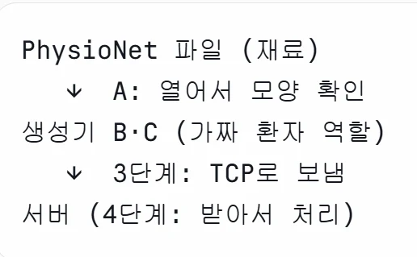

### 목표

- 공개 심전도 데이터 (LTSTDB) 로 가상 환자 N명이 실시간으로 보내는 것 처럼 흉내내는 생성기 만듦
    - 생성기 : 데이터를 만들어 내보내는 프로그램 (가짜 환자 역할)
    - 실시간 : 실제 시간 흐름대로 조금씩 보냄
- 기준
    - 데이터 : LTSTDB (PhysioNet) , 250Hz
        - Hz : 1초에 몇 번 , 250Hz = 1초에 250번 측정
        - LTSTDB : PhysioNet (병원, 연구소가 연구용으로 공개한 의료 데이터 사이트) 안의 심전도 묶음, 사람마다 하루치 기록
        - 4ms : 1 / 250 = 0.004초 (측정과 측정 사이 간격)
        - 샘플 : 측정한 숫자 하나, 그 순간의 전압값
            - 0.1초마다 25샘플씩 보냄 —> 250(1초) x 0.1초 = 25개 (묶으면 1초에 10번이라 훨씬 가벼워짐)
        - 환자마다 시작위치 다르게 세팅
- 전체 흐름
    
    
    
- 기초 용어
    - 청크 (chunk) : 0.1초 분량 25샘플을 잘라낸 덩어리. 코드의 CHUNK = 25
        - 우리는 이걸 상자라고 표현
    - 메시지 (message) : 청크에 환자 번호·순번·시각을 붙여서 보내는 한 건
        - 상자 보내는 단위
    - 메시지 형식 (스키마) : 메시지에 어떤 칸이 들어갈지 정한 양식 (= 송장 양식, 2단계 C)
        - 메시지에 어떤 칸이 들어가는지 정한 양식
    - 패킷과 다름 : 패킷은 네트워크가 내부적으로 데이터를 쪼개는 더 낮은 단계의 단위

### A. 데이터 읽기  (`read_sample.py`)

- 목적 : 공개 심전도 파일에서 앞 10초만 읽어오기
    - 몇 Hz인지, 리드가 몇 개인지, 표가 어떻게 생겼는지 알아야 B와 C에 사용한 코드에 잘라 보낼 수 있어서 사용함
- 설명 : s20011 의 사람을 physioNet의 ltstdb에서 sampto 2500개 (=10초) 까지만 읽어서 데이터 모양 확인
    - 확인하는 것 : 250Hz, 2리드, 표 모양 2500줄 X 2칸 (한 줄 = 한 순간, 한 칸 = 리드 하나)
    - 리드 : 심전도를 재는 방향 (채널), 리드가 많을 수록 심장을 여러 각도에서 확인
    - 2리드 → 3리드 : 기업 기기가 3리드라서 3단계에서 3리드 데이터 변경
    - B,C는 같은 방식으로 1분치 (15,000개)를 읽어서 사용

### B. 환자 1명 (`stream_one.py`)

- 목적 : 환자 1명이 0.1초마다 심전도 25개씩 보내는 흉내 내기. 여러 명으로 늘리기 전에 1명으로 박자대로 잘 잘리는지 먼저 확인
    - stream : 한꺼번에 보내지 않고 조금씩 계속 흘려보내는 것
    - 1명부터 한 이유 : 여러 명으로 늘리기 전에 박자대로 잘 잘리는지 먼저 확인
- 설명 : 1분치를 읽어두고 25개씩 잘라서 0.1초 박자로 10초 동안 반복 재생. 아직 보내지는 않음
    - 반복 재생 : 하루치 기록을 다 읽으면 무거워서 1분만 읽고 돌려씀
    - 아직 안 보내는 이유 : 받을 서버가 아직 없음. 보내는 건 3단계(TCP)

### C. 환자 N명 (`stream_multi.py`)

- 목적 :  환자 N명이 각자 다른 파형을 0.1초 박자에 맞춰 보내게 하기
    - 시작 위치를 다르게 한 이유 : 파일 하나로 여러 명을 흉내 내므로 다 처음부터 틀면 전원이 똑같은 박동을 보내게 됨
- 설명 : B (1명)를 N명으로 늘리는 버전. 0.1초마다 N명 상자를 차례로 만들고, 끝나면 결과를 출력해서 생성기가 박자를 따라가는지 확인
    - 흐름 : 0.1초마다 환자 0번→1번…→ N-1번 순서로 25개씩 잘라 상자를 만듦. 한 바퀴 다 돌면 다음 박자까지 기다린다.
        - 6명이면 0.1초마다 상자 6개 , 1초에 60개
    - B에서 바뀐 것 : 환자 수를 실행할 때마다 정함, 환자마다 시작 위치를 다르게 한다, 끝나고 결과 출력한다.
        - 시작위치 : 환자 0은 3초부터 1은 17초부터 랜덤으로 뽑음. 25 간격으로 뽑아서 상자 경계에 맞춘다.
        - 실행 인자 : 프로그램 이름 뒤에 붙이는 값, 코드 고치지 않고 20명, 100명으로 바꿔 돌리기 가능
        - 출력 3개 : 목표 개수 (환자 X 250) / 실제 개수 / 최대 지각 → 목표랑 실제가 같고 지각이 작으면 생성기는 OK
    - 최대 지각 : 정해둔 시각보다 가장 늦게 보낸 정도. 크면 생성기 자체가 느린 거라 측정을 못 믿음
    - 아직 만들기만 하고 보내진 않음 , 보내는 과정은 3단계에 수행

### D. 결과

- 목적 : 생성기가 환자 100명 분량을 박자 안 놓치고 만들어낼 수 있는지 확인
    - 생성기가 느리면 나중에 서버를 시험할 때 서버가 느린건지 생성기가 느린 건지 구분하기 힘들기 때문에 확인한다.
- 설명 : C를 환자 100명으로 돌림 → 초당 목표 25,000 개 중 24,999 생성 —> 박자 놓치지 않음
    - python stream_multi.py 100 으로 실행 → 10초 동안 돌림 → 끝나고 출력 3개 (목표 개수, 실제 개수, 최대 지각) 확인
        - 25,000 : 목표 개수. 환자 100명 X 1초에 250개
        - 24,999 : 실제 개수.
        - 한계 : 만들기만 하고 아직 보내진 않음. 그래서 아직 서버가 100명을 버티는지 확인할 수 없음
            - 보내기 (3단계, TCP), 받아서 처리는 4단계

### E. 코드 검토 (팀원)

- 목적 : 팀원에게 생성기 코드를 검토받아서 고칠 점 찾기
- 설명 : 메시지 형식이 정해져야 고칠 수 있는 건 보류
    - 메시지 형식 : 상자에 붙이는 송장 양식.
        - 누가 몇 번째로 언제 보냈는지 적는 칸.
- 지적
    1. 생성기랑 서버를 같은 컴퓨터에 돌리면 서버 성능이 낮게 나올 수 있음
        1. 이유 : 둘이 CPU를 나눠 써서 서버가 실제보다 느릴 수 있음
        2. 장점 : 시계가 같아서 지연(받은시간 - 보낸시각) 계산이 정확함
        3. 결정 : 개발할 때는 같이 돌리고 최종 측정에만 컴퓨터를 분리함. 
    2. 시작 위치를 랜덤으로 뽑으면 실행할 때마다 달라져 회차끼리 비교가 어려움 —> 고정값으로 바꿀 예정
