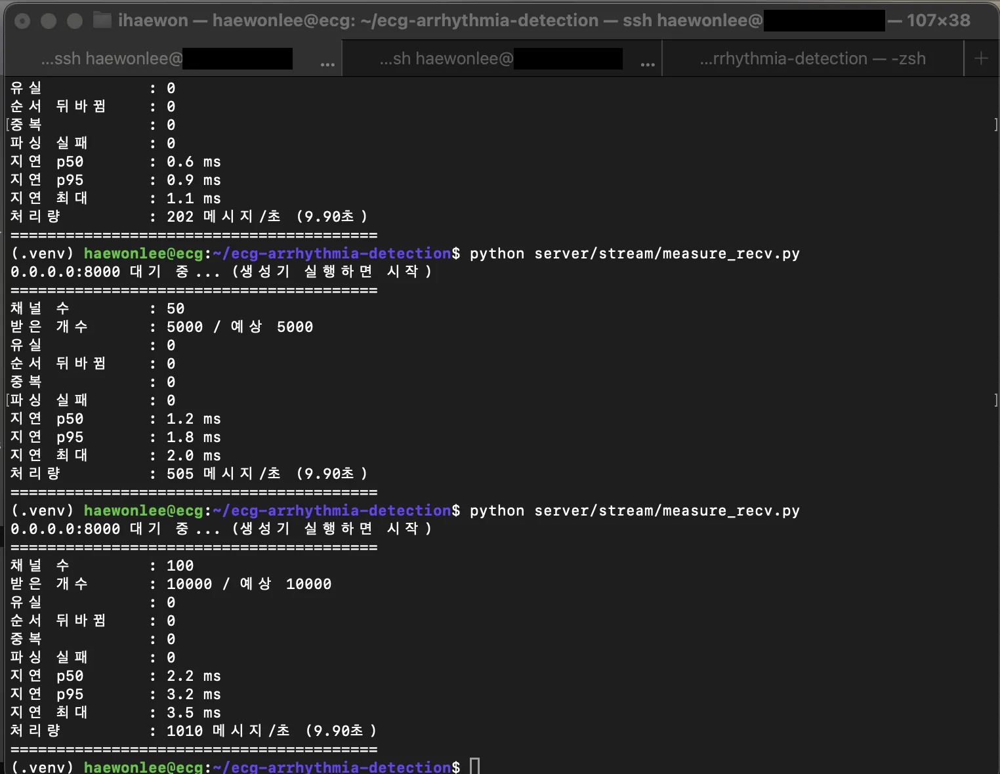

## 목표

생성기에 TCP 전송을 붙이고, 실제 장비와 맞춰 3리드 데이터로 바꾼다. (10.8\~)

## A. 3리드 데이터 조사

- LTSTDB는 기록 이름 첫 숫자가 리드 수 (s2xxxx = 2리드, s3xxxx = 3리드). 3리드 기록 18개 (s30661\~s30801)
  - 3리드: 전극 3개로 심장을 세 방향에서 본 그래프 3줄
  - 12리드: 병원 정밀 검사용 12방향. 그 중 3개를 골라 쓸 수 있음
  - INCART, PTB-XL: LTSTDB 말고 다른 공개 심전도 모음. 박동별 정답(라벨)이 달려 있어 AI 학습·평가용
  - 257Hz, 500Hz처럼 측정 간격이 다르면 250Hz로 맞추는 작업(리샘플링)이 필요함

| 데이터 | 리드 | 샘플링 | 길이 | 용도 |
| --- | --- | --- | --- | --- |
| LTSTDB s3 기록 | 3 | 250Hz | 21\~24시간 | 스트림, 부하테스트 |
| INCART | 12 (I, II, III 사용) | 257Hz | 30분 × 75개 | 정확도 평가 |
| PTB-XL | 12 | 500Hz / 100Hz | 10초 × 2만 개 이상 | AI 학습 |

- 출처: [LTSTDB RECORDS](https://physionet.org/files/ltstdb/1.0.0/RECORDS), [INCART](https://physionet.org/files/incartdb/1.0.0/README), [PTB-XL](https://physionet.org/content/ptb-xl/1.0.3/)

## B. TCP 생성기 — `stream_tcp.py`

```bash
python server/stream/stream_tcp.py 환자수 --host 127.0.0.1 --port 8000 --record s30661 --seconds 10
```

- `--host 127.0.0.1` : 보낼 주소. 127.0.0.1은 자기 자신(같은 컴퓨터). 다른 컴퓨터로 보내려면 그 주소(예: `<Tailscale IP>`)
- `--port 8000` : 보낼 문 번호 / `--record` : 재생할 기록 / `--seconds` : 몇 초 보낼지
- `socket.create_connection` 으로 한 번 연결하고 계속 보냄
  - socket: 프로그램끼리 네트워크로 대화하는 창구. create_connection = 상대 주소의 문에 연결
- 0.1초마다 환자 N명분 메시지를 묶어서 `sendall` 한 번으로 전송
  - sendall: 가진 데이터를 끝까지 다 보낼 때까지 보내는 함수
- 받는 쪽이 끊기면 멈추고 보낸 개수 출력

```python
sock = socket.create_connection((args.host, args.port))

start = time.time()
next_tick = start
ticks = round(args.seconds / INTERVAL)

for _ in range(ticks):
    lines = []
    for i in range(args.n):
        p = pos[i]
        if p + CHUNK > total:   # 1분 끝나면 처음부터
            p = 0
        chunk = signal[p:p + CHUNK]
        msg = {
            "channel_id": i,
            "seq": seq[i],
            "t_start": round(seq[i] * INTERVAL, 1),
            "sent_at": time.time(),
            "fs": FS,
            "duration": INTERVAL,
            "leads": leads,
            "samples": [[round(float(v), 3) for v in chunk[:, k]] for k in range(len(leads))],
        }
        lines.append(json.dumps(msg) + "\n")
        pos[i] = p + CHUNK
        seq[i] += 1
    sock.sendall("".join(lines).encode())
    sent += args.n

    worst_late = max(worst_late, time.time() - next_tick)
    next_tick += INTERVAL
    wait = next_tick - time.time()
    if wait > 0:
        time.sleep(wait)
```

- 1단계 `stream_multi.py`의 비어 있던 `send()` 자리를 TCP 전송으로 채운 것
- `ticks` : 반복 횟수. 10초면 100번. 시간 대신 횟수로 돌림 (트러블슈팅 1)
- `msg` : 상자 하나. 칸 뜻은 2단계 E-4
- `seq[i]` : 환자별 송장 번호. 보낼 때마다 1씩 늘림
- `"sent_at": time.time()` : 보낸 시각. 받는 쪽에서 빼서 지연 계산
- `chunk[:, k]` : k번째 리드의 25개. 리드 3개면 `samples`가 3줄
- `round(..., 3)` : 소수 셋째 자리까지만. 글자 수 줄이려고
- `json.dumps(msg) + "\n"` : 상자를 글자로 바꾸고 줄바꿈 붙이기 (NDJSON)
- `"".join(lines).encode()` : 환자 N명 줄을 이어 붙여 바이트로 바꿈 → `sendall` 한 번에 전송
- `worst_late` : 최대 지각. 1단계와 같은 방식
- 실제 파일에는 실행 인자 읽기, 연결 끊김 처리, 끝나고 출력하는 부분이 더 있음

## C. 확인

- 가짜 수신 서버로 테스트: 환자 100명 × 3초 → 3,000개 보내고 3,000개 받음, 최대 지각 18ms
- ecg VM에서 s30661 읽기: 리드 `['V4', 'V3', 'II']`, 250Hz, `(2500, 3)`
  - V4, V3, II: 리드 이름. 기록마다 다름 (다른 기록은 E-S, A-S, A-I)
  - (2500, 3): 2,500줄(10초) × 3리드 모양의 표
  - ecg VM: 미니PC 안에 만든 산학 전용 가상 컴퓨터
- ecg VM에서 nc로 실제 수신 (터미널 탭 2개: 받는 쪽 / 보내는 쪽)

```bash
# 받는 쪽
nc -l 8000 | wc -l
# 보내는 쪽
python server/stream/stream_tcp.py 10 --seconds 5
```

- 1명 × 2초: 메시지가 형식 그대로 도착
- 10명 × 5초: 500개 보내고 500개 받음, 유실 0
- `nc` : 받는 서버를 흉내 내는 도구. 수신부 없이도 보내는 쪽만 따로 검사할 수 있음
- `wc -l` : 줄 수 세기. NDJSON은 한 줄 = 메시지 1개라 줄 수가 곧 받은 개수

## D. 측정용 수신기와 환자 수별 측정

- `measure_recv.py` : 8000번에서 받아서, 끝나면 받은 개수·유실·순서 뒤바뀜·지연 p50/p95/최대·처리량 출력
  - 순서 뒤바뀜: 5번 다음에 4번이 온 경우. TCP라 보통 0
  - 처리량: 1초에 받은 상자 수. 환자 수 × 10이면 정상
  - p50 / p95 / 최대: 중간값 / 100개 중 느린 순서 5번째 / 가장 느린 것
- 지연 = 받은 시각 − `sent_at`. 생성기와 같은 VM에서 돌려야 시계가 같아서 값이 맞음
- 유실 = 채널별로 `seq`가 빠진 개수

```python
async def handle(reader, writer):
    while True:
        line = await reader.readline()
        if not line:
            break
        now = time.time()
        msg = json.loads(line)
        ch = msg['channel_id']
        seq = msg['seq']
        sent_at = msg['sent_at']

        stats.received += 1
        stats.latencies.append(now - sent_at)

        seen = stats.seen.setdefault(ch, set())
        if seq in seen:
            stats.duplicate += 1
        seen.add(seq)

        prev = stats.last_seq.get(ch)
        if prev is not None and seq < prev:
            stats.out_of_order += 1
        stats.last_seq[ch] = seq

def report():
    lost = 0
    for seqs in stats.seen.values():
        lost += (max(seqs) + 1) - len(seqs)
```

- `async` / `await` : 기다리는 동안 다른 일을 할 수 있게 하는 파이썬 방식. 여기선 연결이 끊길 때까지 계속 읽음
- `reader.readline()` : 줄바꿈까지 읽기. NDJSON이라 한 줄 = 메시지 1개
- `if not line: break` : 빈 값이면 연결이 끊긴 것
- `now - sent_at` : 받은 시각 − 보낸 시각 = 지연. 모아두었다가 마지막에 정렬해서 p50, p95, 최대 계산
- `stats.seen` : 환자별로 받은 seq 모음. `set`은 중복 없는 모음이라 같은 번호가 또 오면 중복으로 셈
- `seq < prev` : 직전 번호보다 작으면 순서 뒤바뀜
- `(max(seqs) + 1) - len(seqs)` : 0번부터 마지막 번호까지면 원래 max+1개가 와야 함. 실제 받은 개수를 빼면 빠진 개수 = 유실
- 실제 파일에는 형식 오류 처리, 처리량 계산, 마지막 연결이 끊기고 1초 지나면 종료하는 부분이 더 있음

```bash
# 탭1: 받는 쪽
python server/stream/measure_recv.py
# 탭2: 보내는 쪽
python server/stream/stream_tcp.py 100 --seconds 10
```

| 환자 수 | 받은 개수 | 유실 | 지연 p50 | 지연 p95 | 지연 최대 | 처리량 |
| --- | --- | --- | --- | --- | --- | --- |
| 6 | 600 / 600 | 0 | 0.4ms | 0.5ms | 0.6ms | 61개/초 |
| 20 | 2,000 / 2,000 | 0 | 0.6ms | 0.9ms | 1.1ms | 202개/초 |
| 50 | 5,000 / 5,000 | 0 | 1.2ms | 1.8ms | 2.0ms | 505개/초 |
| 100 | 10,000 / 10,000 | 0 | 2.2ms | 3.2ms | 3.5ms | 1,010개/초 |

- 한계: 보내는 구간만 잰 값. 큐·워커 처리 시간은 빠져 있어서 실제 부하테스트는 워커 붙인 뒤 다시 잼



## E. 자세히 보기 (공부용)

### 1. 생성기가 보내는 흐름

```plain text
연결 한 번 (create_connection)
  ↓
0.1초마다 반복
  환자 0 상자 + 환자 1 상자 + ... + 환자 N-1 상자  → 한 줄씩 이어 붙여서
  sendall 한 번으로 전송
  ↓
끝나면 보낸 개수 / 목표 개수 / 최대 지각 출력
```

- 1단계에서 비워둔 “보내기” 자리에 실제 TCP 전송을 넣은 것
- 환자별로 따로 보내지 않고 묶어서 한 번에 보냄 → 보내는 횟수가 줄어서 빠름
- 받는 쪽이 없으면 `Connection refused`, 중간에 끊기면 “받는 쪽 연결이 끊김” 출력 후 멈춤

### 2. 왜 3리드로 바꿨나

- 기존 데이터(s20011)는 2리드라 상자 안 내용물 모양이 다름
- 조교 피드백: 계산으로 만든 가짜 3번째 리드 대신 진짜 3리드 데이터로 연습
- 리드 이름이 기록마다 다름 (s30661은 V4·V3·II, 나머지 대부분 E-S·A-S·A-I). 그래서 이름을 고정하지 않고 상자의 leads 값을 보고 처리해야 함

### 3. nc로 먼저 확인한 이유

- 받는 쪽(수신부)이 아직 없을 때, 보내는 쪽만 따로 검사하려고
- `nc -l 8000` = 8000번 문 앞에 서서 받은 걸 그대로 화면에 찍는 허수아비. 상자 모양이 맞는지 눈으로 볼 수 있음
- `| wc -l` 붙이면 줄 수 = 받은 상자 수

### 4. 측정용 수신기가 하는 일

- nc는 개수만 알려줌. 빠진 번호, 순서, 지연까지 보려고 만듦
- 상자가 올 때마다: 받은 시각 − sent_at = 지연 기록 / 환자별로 seq 모아두기
- 연결이 끊기고 1초 동안 아무것도 안 오면 종료하고 결과 출력
- 유실 = (마지막 seq + 1) − 받은 개수. 순서 뒤바뀜 = 앞 번호보다 작은 번호가 온 횟수
- 일부러 1개 빼고 1개 순서 바꿔서 보내봤을 때 유실 1, 뒤바뀜 1로 잡는 것 확인함

### 5. 결과표 읽는 법

- 처리량: 환자 수 × 10 랑 거의 같으면 정상 (100명 → 1,010개/초)
- p95: 상자 100개 중 느린 순서로 5번째. 평균은 느린 몇 개를 가려서 p95를 봄
- 환자가 늘수록 지연이 조금씩 늘어남 (0.5 → 3.2ms). 한 번에 보내는 양이 늘어서
- 여기 지연은 “보내는 구간”만. 실제 기준은 큐 대기와 처리까지 포함해야 해서 4단계에서 다시 재

```plain text
생성기 ──▶ 받음                                  ← 여기(3단계): 100명 p95 3.2ms
생성기 ──▶ 수신부 ──▶ Redis 대기 ──▶ 처리 끝   ← 4단계: 20명 p95 23~27ms
```

## 트러블슈팅

### 메시지가 목표보다 10개 더 나감

- 증상: 10명 × 3초 목표 300개인데 310개 전송
- 원인: `next_tick < end` 조건으로 반복. 0.1을 계속 더하면 소수 오차로 3.0보다 살짝 작은 값이 나와 한 번 더 돈
- 해결: 시간 대신 횟수로 반복 (`for _ in range(round(seconds / 0.1))`)

### push 거부 (non-fast-forward)

- 원인: 팀원이 먼저 올린 커밋 2개를 내 로컬에 안 받음
- 해결: `git pull` 후 다시 push

## 남은 작업

- [x] nc로 VM에서 실제 수신 확인
- [x] 10명 × 5초 = 500개 전부 도착하는지 확인
- [ ] 실제 장비 3리드 조합 확인 (LTSTDB는 V4, V3, II)
- [x] 측정용 수신기로 환자 6·20·50·100명 측정
- [ ] 메시지 형식 맞추기
