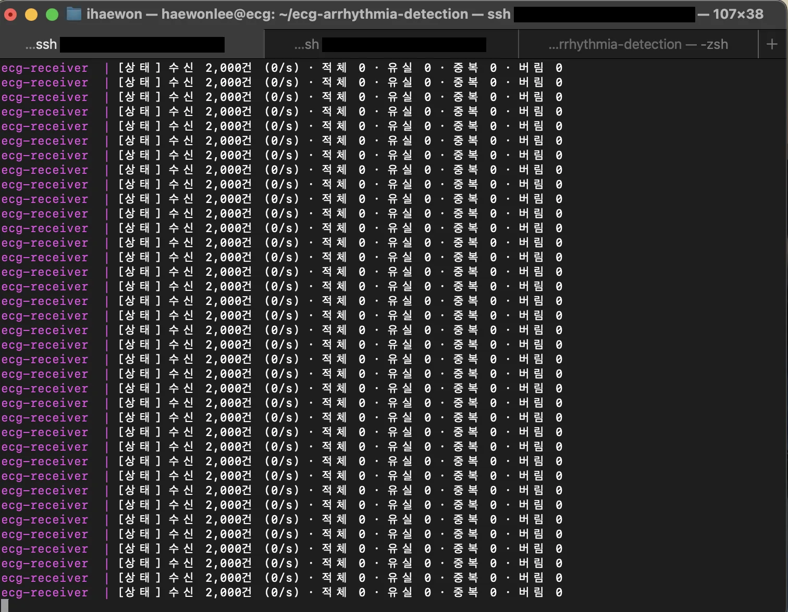
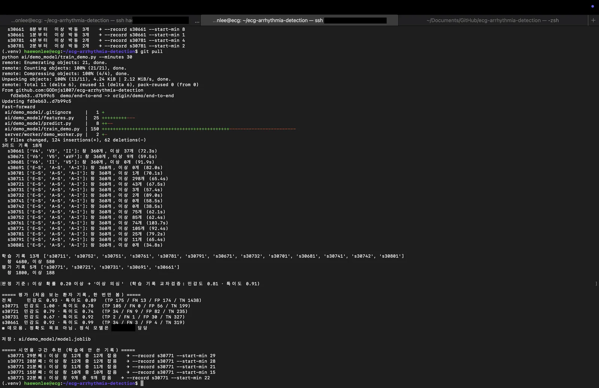
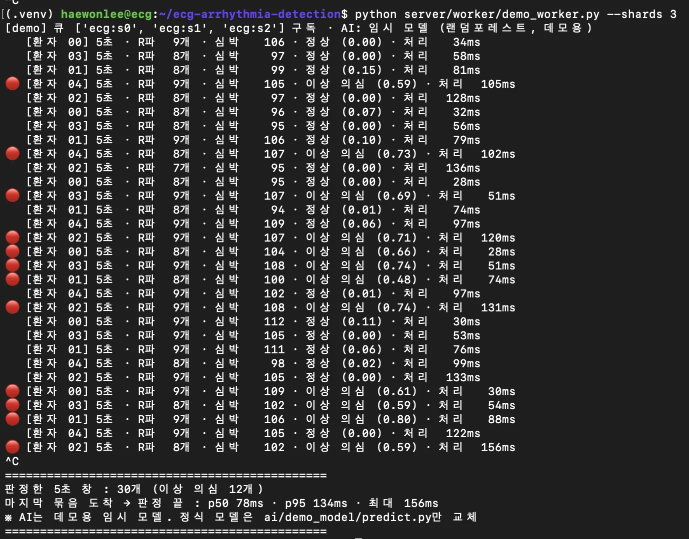

## 목표

팀원이 만든 수신부·Redis·워커를 테스트 서버(ecg VM)에 띄우고, 내 생성기와 연결해 끝까지 이어지는지 확인한다. 시연용으로 R파 검출과 임시 AI 판정까지 붙인다. (10.8)

## A. 수신부·큐·워커 연결

- 수신부·Redis·워커 3개를 도커 컴포즈로 한 번에 띄움. VM이 4코어라 워커는 3개
    - 도커: 프로그램을 필요한 환경째 상자(컨테이너)에 담아 어디서든 똑같이 돌리는 도구
    - 도커 컴포즈: 컨테이너 여러 개를 파일 하나(docker-compose.yml)로 한 번에 켜고 끄는 도구
    - 코어: CPU 안의 일꾼 수. 4코어면 동시에 4가지 일을 함. 워커 3개 + 나머지 1개는 수신부·Redis용

```bash
SHARDS=3 docker compose up -d --build redis receiver w0 w1 w2
docker compose logs -f receiver w0 w1 w2
# 다른 탭
python server/stream/stream_tcp.py 20 --seconds 10
```

- `SHARDS=3` : 워커(샤드) 수. 실제로 띄운 워커 수와 같아야 함. 다르면 일부 환자 상자를 아무도 안 가져감
- `up -d` : 백그라운드로 켜기 (터미널 꺼도 계속 돔) / `--build` : 이미지 새로 만들기
- `redis receiver w0 w1 w2` : 켤 컨테이너 이름 (Redis, 수신부, 워커 3개)
- `logs -f` : 로그를 계속 따라가며 보기. 끄는 건 Ctrl+C (컨테이너는 안 꺼짐)

| 항목 | 결과 (20명 × 10초) |
| --- | --- |
| 보냄 / 받음 | 2,000 / 2,000 |
| 유실 · 중복 · 검증 실패 | 0 · 0 · 0 |
| 워커별 처리 | 700 / 700 / 600 |
| 끝단 지연 p50 / p95 | 15\~17ms / 23\~27ms |



- 끝단 지연 = 워커 처리 끝난 시각 − 생성기가 보낸 시각. 3단계에서 잰 "보내는 구간"(100명 p95 3.2ms)과 다르게 큐 대기·처리까지 포함
- 워커는 아직 3ms 동안 일하는 척만 하는 껍데기. 진짜 분석이 붙으면 다시 재야 함
- `channel_id % 워커 수`로 같은 환자는 항상 같은 워커로 감. R파 검출이 환자별 상태(적응형 임계값)를 들고 있어서
    - %: 나머지. 7 % 3 = 1 → 환자 7은 w1
    - 샤딩: 데이터를 규칙에 따라 여러 갈래로 나눠 담는 것
    - 적응형 임계값: R파로 볼 기준선을 그 환자 신호 크기에 맞춰 계속 조절하는 것

### 자세히 보기

A\~C를 한 단계씩 풀어쓴 것. 비유는 전부 “심전도 택배 물류센터”로 통일함.

- 앞 단계 내용은 각 페이지에 있음: 생성기 박자 맞추기(1단계), 메시지 칸·TCP·NDJSON(2단계), 보내는 구간 측정(3단계)

#### 1. 큰 그림

```
[ecg VM 한 대 안에서 전부 돔]

생성기 ──TCP 8000──▶ 수신부 ──▶ Redis ──┬──▶ 워커 w0, w1, w2   (지연 측정)
(가짜 환자)            (접수 창구)  (컨베이어) └──▶ 데모 워커         (R파 + 임시 AI)
```

| 칸 | 비유 | 실제로 하는 일 |
| --- | --- | --- |
| 생성기 (내 코드) | 택배 보내는 사람들 | 공개 심전도 파일을 읽어서 환자 N명이 0.1초마다 데이터를 보내는 척함 |
| TCP 8000 | 도로 | 한 번 연결하면 순서대로, 빠짐없이 도착하는 통로 |
| 수신부 | 접수 창구 | 상자를 받아 송장 검사 → 빠진 번호 세기 → 어느 직원한테 줄지 정해서 컨베이어에 올림 |
| Redis | 컨베이어 벨트 | 상자가 몰려도 줄 세워두고 차례로 넘김. 서버가 안 죽게 하는 완충지대 |
| 워커 | 분류 직원 | 상자를 꺼내 처리. 지금은 3ms 일하는 척만 하고 지연만 잼 |
| 데모 워커 | 검사관 | 같은 상자를 따로 받아서 5초씩 모아 R파 찾고 임시 AI로 판정 |

#### 2. 상자 하나 뜯어보기

- 메시지 칸별 설명은 2단계 C 아래 자세히 보기에 있음
- 환자 1명 = 1초에 상자 10개. 20명 × 10초 = 2,000개. 100명이면 1초에 1,000개

#### 3. 수신부가 하는 일 4가지

1. 검사: 필수 칸(channel_id, seq, sent_at, fs, samples)이 없거나 리드별 길이가 다르면 세고 버림. 멈추지 않음 (한 명 상자 깨졌다고 99명 감시가 멈추면 더 큰 사고)
2. 유실 세기: 환자별로 직전 seq만 기억. 5 다음 8이 오면 유실 2
3. 직원 배정: `channel_id % 3` → 환자 0, 3, 6은 w0 / 1, 4, 7은 w1 / 2, 5, 8은 w2. 같은 환자는 항상 같은 직원
4. 묶어서 올리기: 50건씩 모아서 Redis에 한 번에 넣음. 안 차도 5ms 지나면 보냄
- 덧붙여: 내 생성기는 sent_at을 초 단위(1791432323.07)로 보내는데, 수신부가 ms(1791432323070)로 바꿔서 넣어줌
- 왜 같은 환자는 같은 직원? R파 검출은 “이 환자 평소 R파 크기”를 기억하면서 돌아감. 직원이 바뀌면 그 기억이 끊김

#### 4. Redis Streams (컨베이어)

- 컨베이어가 3개: `ecg:s0`, `ecg:s1`, `ecg:s2`. 직원 한 명당 벨트 하나
- 명령어 3개만 알면 됨
    - XADD: 벨트에 상자 올리기 (수신부)
    - XREADGROUP: 벨트에서 상자 가져가기 (워커)
    - XACK: “처리 끝났음” 도장 (워커). 도장 안 찍은 건 “처리 중”으로 남아서 직원이 죽어도 다시 처리 가능
- 컨슈머 그룹 = 구독자 모임. 신문 한 부를 두 집이 각자 구독하는 것처럼, 기존 워커(그룹 cg)와 데모 워커(그룹 demo)가 같은 상자를 각자 받음. 서로 방해 안 함
- 적체 = 벨트 위에 쌓인 상자 수. 계속 늘어나면 직원이 못 따라가는 것. 오늘은 전송 중 17, 끝난 뒤 0

#### 5. 지연은 두 종류

```
생성기 ──▶ 받음  ← 3단계: “보내는 구간” 100명 p95 3.2ms
생성기 ──▶ 수신부 ──▶ Redis 대기 ──▶ 워커 처리 끝  ← 4단계: “끝단” 20명 p95 23~27ms
```

- 목표 기준 “채널당 처리지연 2초”는 끝단 쪽. 2초 = 2,000ms니까 지금은 약 1.3%
- 단 워커가 3ms 일하는 척만 한 것. 진짜 R파+AI가 붙으면 다시 재야 의미 있음
- p95 = 상자 100개 중 느린 순서로 5번째. 평균은 느린 몇 개를 가려서 p95를 봄

## B. 시연용 R파 검출 + 임시 AI 판정

- 워커 뒤의 R파·AI가 아직 파이프라인에 없어서, 끝까지 이어지는 걸 보여주려고 시연용으로 붙임. AI 정식 모델은 담당 팀원이 만들어 교체 예정
- Redis 컨슈머 그룹을 따로(`demo`) 만들어 기존 워커와 같은 데이터를 나란히 읽음 → 기존 지연 측정에 영향 없음
    - 컨슈머 그룹: 같은 큐를 구독하는 모임. 그룹이 다르면 같은 상자를 각자 받음 (4단계 A 아래 자세히 보기)
    - 파이프라인: 생성기부터 판정까지 데이터가 차례로 거치는 길 전체

```
생성기 → 수신부 → Redis ─┬→ 워커 3개 (지연 측정)
                        └→ 데모 워커: 5초 모음 → R파 → 임시 AI → 출력
```

| 파일 | 하는 일 |
| --- | --- |
| `server/worker/demo_worker.py` | 환자별로 0.1초 묶음 50개를 모아 5초 창(3×1250) 완성 → R파 → 판정 → 한 줄 출력 |
| `ai/demo_model/features.py` | Pan-Tompkins(py-ecg-detectors)로 R파 찾기 + 특징 10개 (심박, R-R 불규칙성, 박동 모양 유사도, 박동 폭 등) |
| `ai/demo_model/train_demo.py` | LTSTDB 3리드 18개 기록으로 랜덤포레스트 학습. 기록(환자) 단위로 학습·평가 분리 |
| `ai/demo_model/predict.py` | 판정 자리. 정식 모델은 이 파일만 바꾸면 됨 |

```python
# 데모 워커에서 5초가 찼을 때
win = np.concatenate(buf[ch], axis=1)[:, :WIN]   # [3, 1250]
rp = detect_r(win[pick_lead(win)])               # R파 위치
label, p = model.predict(win, leads, rp)          # 임시 AI 판정
```

- `buf[ch]` : 환자별 바구니. 0.1초 상자를 여기 모음
- `np.concatenate(..., axis=1)` : 상자들을 옆으로 이어 붙여 긴 줄로 만듦
- `WIN` : 1,250 = 5초 분량
- `pick_lead` : 3줄 중 신호가 가장 뚜렷한 리드 고르기 / `detect_r` : R파 위치 찾기
- `model.predict` : 임시 AI에 넣어서 (라벨, 이상 확률) 받기
- 랜덤포레스트: 스무고개 나무 여러 개의 다수결로 판정하는 머신러닝 (아래 자세히 보기)
- 입력을 5초 고정 창으로 한 이유: 실시간 탐지는 시간 기준이 입력 크기·지연 관리에 유리 (조교 피드백)
- 라벨: 5초 안에 이상 박동(V, A, S 등)이 하나라도 있으면 이상
- 판정 기준은 민감도 우선. 놓치는 게(미탐) 잘못 울리는 것보다 치명적이라서
    - 민감도: 실제 이상 중 잡은 비율 / 특이도: 실제 정상 중 정상이라고 한 비율 (아래 자세히 보기)
    - 미탐: 이상인데 못 잡음 / 오탐: 정상인데 잘못 울림
    - 교차검증: 학습 데이터를 몇 묶음으로 나눠 돌아가며 시험해보는 것 (아래 자세히 보기)
- 결과 (기록당 30분, 학습 13명 / 평가 5명, 판정 기준 확률 0.20)

| 구분 | 민감도 | 특이도 |
| --- | --- | --- |
| 학습 기록 안 교차검증 | 0.81 | 0.91 |
| 처음 보는 환자 5명 (이상 188 / 정상 1,612창) | 0.93 | 0.89 |
- 민감도를 우선해서 판정 기준을 0.5 → 0.20으로 낮춤. 대신 오탐 174개로 실제 사용 수준은 아님
- 기록별 편차 큼 (민감도 0.67\~1.00, 특이도 0.74\~0.99). 데이터 18명으로는 일반화 판단 어려움



### 자세히 보기

#### 6. 데모 워커: 5초 창 만들기

- 환자별 바구니에 0.1초 상자를 넣다가 50개(= 5초 = 1,250샘플) 차면 꺼냄
- 모양: [3, 1250] = 리드 3줄 × 숫자 1,250개
- 5초로 한 이유: 조교 피드백 “실시간이면 시간 기준이 크기·지연 관리에 유리”. 박동 기준이면 심박에 따라 길이가 달라져서 AI에 넣기 전에 길이를 맞춰야 함

#### 7. Pan-Tompkins (R파 찾기)

- R파 = 심전도에서 가장 뛰어오른 뾰족한 봉우리. 박동 하나에 하나
- 순서 (감만 잡기)
    1. 필터: 너무 느린 흔들림, 너무 빠른 잡음을 걸러냄
    2. 미분: 갑자기 변하는 곳을 크게 (R파는 가장 가파름)
    3. 제곱: 음수도 양수로, 큰 건 더 크게
    4. 이동창 적분: 0.15초씩 묶어 평활하게 → 봉우리마다 언덕 하나
    5. 기준선 넘는 언덕 = R파. 기준선은 최근 값 보면서 계속 조절 (적응형 임계값)
- 4번에서 묶는 바람에 위치가 약 0.1초 뒤로 밀림 → 찍힌 위치 앞쪽에서 진짜 꼭대기를 다시 찾아 보정함 (트러블슈팅 1)
- 리드 고르기: 3줄 중 기울기가 가장 큰 줄로 찾음. 기록마다 리드 이름이 달라서 (트러블슈팅 2)

#### 8. 임시 AI가 보는 숫자 10개

사진을 통째로 보는 게 아니라, 5초 창에서 숫자 10개만 뽑아서 판단함.

| 묶음 | 숫자 | 이상 박동이면 어떻게 변하나 |
| --- | --- | --- |
| 박동 수·속도 | n_beats, hr(심박) | 너무 빠르거나 느리면 의심 |
| 간격 고른가 | rr_cv, rr_min_ratio, rr_max_ratio, rr_jump | 조기수축은 박동이 너무 일찍 와서 간격이 갑자기 짧아짐 → rr_min_ratio가 작아짐 |
| 모양 비슷한가 | corr_min, corr_mean | 박동들을 “평균 박동”과 비교. 하나만 모양이 확 다르면 corr_min이 낮아짐 |
| 크기·폭 | amp_cv, width_ratio_max | 심실에서 생긴 조기수축(V)은 박동이 넓고 크기가 다름 |

#### 9. 랜덤포레스트

- “심박 100 넘어? → 간격 최소가 0.7 미만? → …” 이런 스무고개 나무를 300개 만들고, 다수결로 판정
- 나무마다 데이터를 조금씩 다르게 보고 배워서, 하나가 틀려도 다수가 바로잡음
- 출력 = “이상”에 표 던진 나무 비율 = 확률 (화면의 0.59 같은 숫자)
- 딥러닝이 아니라 가벼운 머신러닝. 임시용으로 빠르고 학습도 몇 분이면 됨

#### 10. 학습과 평가

- 라벨(정답): LTSTDB에는 의사가 박동마다 N(정상), V(조기심실수축) 등을 달아둠. 5초 안에 이상 기호가 하나라도 있으면 “이상 창”
- 데이터: 3리드 기록 18명 × 앞 30분 = 창 6,480개
- 환자 단위 분할: 13명으로 공부, 나머지 5명으로 시험. 같은 사람으로 공부하고 시험 보면 점수가 뻥튀기됨 (문제집 그대로 시험 나오는 것)
- 판정 기준 고르기: 공부용 13명을 4묶음으로 나눠 “3묶음으로 배우고 1묶음으로 풀기”를 돌려가며 해봄(교차검증). 이상의 80%를 잡는 가장 높은 기준 = 0.20. 시험용 5명은 마지막에 딱 한 번만 봄

#### 11. 민감도와 특이도 (실제 숫자로)

|  | AI가 “이상” | AI가 “정상” |
| --- | --- | --- |
| 실제 이상 188개 | 175 (잡음) | 13 (놓침 = 미탐) |
| 실제 정상 1,612개 | 174 (잘못 울림 = 오탐) | 1,438 (맞게 둠) |
- 민감도 = 175 / 188 = 0.93. 진짜 이상을 얼마나 잡았나
- 특이도 = 1,438 / 1,612 = 0.89. 진짜 정상을 얼마나 조용히 두었나
- 기준을 낮추면(0.5 → 0.2) 더 잘 울리니까 민감도 올라가고 오탐도 늘어남. 화재경보기 감도를 올리는 것과 같음
- 이 프로젝트는 미탐이 더 치명적 → 민감도를 먼저 봄

#### 재학습 없이 평가 + 정확도·F1 추가 (10/9)

- 목적 : 지표를 다시 볼 때마다 학습(몇 분)을 다시 돌리지 않으려고, 저장된 모델로 평가만 다시 하는 `eval_demo.py`를 만듦. 민감도·특이도에 정확도·F1도 같이 출력
- 설명 : 학습할 때 `model.joblib`에 모델·판정 기준·평가 기록 목록(`test_records`)을 같이 저장해둠 → `eval_demo.py`가 그걸 읽고, `cache/`에 받아둔 평가 기록으로 5초 창을 다시 만들어 판정만 함
    - `cache/` : 10/8에 PhysioNet에서 받은 기록을 `기록_30m.npz`로 저장하게 바꿔둠. 그래서 다시 받지 않고 바로 평가 가능
    - joblib : 학습한 파이썬 모델을 파일로 저장하고 불러오는 도구

```bash
python ai/demo_model/eval_demo.py
```

```python
acc = (tp + tn) / max(1, tp + tn + fp + fn)
prec = tp / (tp + fp) if tp + fp else float("nan")
f1 = 2 * prec * sens / (prec + sens) if tp else 0.0
```

- 정확도 : 전체 창 중 맞힌 비율
- 정밀도 : AI가 "이상"이라고 한 것 중 진짜 이상인 비율
- F1 : 민감도와 정밀도를 같이 본 점수. 둘 중 하나라도 낮으면 낮게 나옴
- 클래스 불균형 : 정상 창이 이상 창보다 훨씬 많은 상태. 이때 정확도만 보면 속음
- 결과 (10/13 기록) : 민감도 0.93, 특이도 0.89, F1 0.65
    - 위 11번 표(TP 175 / FN 13 / FP 174 / TN 1,438)로 계산하면 정확도 0.90
    - 전부 "정상"이라고만 해도 정확도는 1,612 / 1,800 = 0.90. 그래서 정확도만 보면 안 되고 민감도·F1을 같이 봄

#### CNN 모델 서버 연결 (10/13)

- 목적 : AI 담당 팀원이 만든 1D-CNN을 시연 워커에 붙여서, 임시 모델 대신 실제 모델로 R파 → 판정까지 이어지는지 확인
- 설명 : 정식 학습 데이터가 정해지기 전이라 시연용 LTSTDB 캐시로 학습 데이터를 만듦 → 팀원 `train.py`로 학습 → 같은 평가 기록으로 지표 4개 + 추론 시간 → 시연 워커에 `--model cnn`
    - 1D-CNN : 신호를 한 줄(시간 순서)로 훑으면서 모양 패턴을 배우는 딥러닝 모델
    - 추론 : 학습 끝난 모델에 입력을 넣어 판정 받는 것. 추론 시간 = 창 1개 판정에 걸린 시간

| 파일 | 하는 일 |
| --- | --- |
| `ai/demo_model/make_npz.py` | LTSTDB 3리드 캐시를 5초 창 `X [N, 3, 1250]`, 정답 `y`, 환자 번호로 묶어 `cnn_train.npz` / `cnn_test.npz` 생성 |
| `ai/demo_model/eval_cnn.py` | 평가 기록으로 민감도·특이도·정확도·F1 + 창 1개 추론 p50/p95 (CPU) |
| `ai/demo_model/cnn_model.py` | 팀원 `predict.py`를 불러와 시연 워커 표기(이상 의심/정상/판정 불가)로 바꿔주는 어댑터 |
| `server/worker/demo_worker.py` | `--model cnn` 옵션 추가. 5초 안에 `lead_off`가 있으면 판정 불가 |
| `.gitignore` | 학습 결과물 `model.pt`, `model.json`은 올리지 않음 (각자 VM에서 학습) |

```bash
python ai/demo_model/make_npz.py --minutes 30      # 학습·평가 데이터 만들기
# 팀원 train.py 에 --data 로 cnn_train.npz 넘겨서 학습 → ai/AI모델/model.pt
python ai/demo_model/eval_cnn.py                   # 지표 4개 + 추론 시간
python server/worker/demo_worker.py --shards 3 --model cnn
```

- npz : 넘파이 배열 여러 개를 파일 하나에 압축 저장하는 형식
- 어댑터 : 서로 모양이 다른 두 코드를 이어주는 중간 코드. 팀원 원본은 안 고침
    - 이름 충돌 : `predict.py`가 임시 모델 쪽과 CNN 쪽에 둘 다 있어서, 파일 경로로 직접 지정해서 불러옴
- lead_off : 전극이 떨어졌다는 표시. 떨어진 신호로 판정하면 틀리니까 "판정 불가"로 냄
- 정한 것
    - 환자 분할은 임시 모델(`train_demo.py`)과 똑같이 → 두 모델을 같은 평가 기록으로 비교 가능. 시연 기록 s30661은 평가 쪽
    - 리드 이름을 고정하지 않고 학습 (`--lead-order` 안 줌). LTSTDB는 기록마다 리드 구성이 달라서 (트러블슈팅 2와 같은 이유)
- 결과 (같은 평가 기록) : 민감도 0.43, 특이도 0.69, F1 0.21
    - 임시 모델(민감도 0.93, F1 0.65)보다 낮음. 모델 문제보다 학습 데이터 문제로 봄 (시연용 LTSTDB 18명뿐이라 양이 적음)
    - 연결 자체는 성공. 서버 쪽은 판정 파일만 바꾸면 모델을 갈아끼울 수 있는 구조가 됐음
    - 창 개수·추론 시간 출력은 기록에 없음
- 이후 : 다음 날(10/14) 서버 담당 팀원이 `demo_worker.py`를 `worker.py`로 합침 (`--analyze real --model ...`)

## C. 시연 리허설

```bash
python server/worker/demo_worker.py --shards 3                                   # 탭1
python server/stream/stream_tcp.py 5 --seconds 30 --record s30661 --start-min 1   # 탭2
```

```
   [환자 00] 5초 · R파  9개 · 심박   106 · 정상 (0.00) · 처리   34ms
🔴 [환자 04] 5초 · R파  9개 · 심박   105 · 이상 의심 (0.59) · 처리  105ms
```



- 생성기 → 수신부 → Redis → R파 → 임시 AI까지 한 화면에서 확인
- 30줄 중 이상 의심 12줄. 마지막 묶음 도착 → 판정 끝 p50 78ms, p95 134ms, 최대 156ms. 실제 이상 박동은 3개 정도라 일부는 오탐 (민감도 우선 기준의 대가)
- 처리 시간이 30 → 150ms로 늘어남. 환자 5명 창이 동시에 차고 워커 하나가 차례로 처리해서 뒤 순서일수록 대기가 붙음 (한 명당 약 25ms) → 워커를 여러 개로 나누는 이유

### 자세히 보기

#### 12. 시연 화면 읽는 법

```
🔴 [환자 04] 5초 · R파  9개 · 심박   105 · 이상 의심 (0.59) · 처리  105ms
   누구       창     박동 수      분당 박동   판정      이상 확률   마지막 상자 도착 → 판정
```

- 5초에 R파 9개면 심박 약 108. 숫자가 서로 맞는지 확인 가능
- 처리 시간이 환자 순서대로 30 → 150ms로 늘어남: 5명 창이 동시에 차고 데모 워커 하나가 한 명씩(약 25ms) 처리. 줄 뒤쪽일수록 기다린 시간이 붙음 → 그래서 직원을 여러 명 둔 구조가 필요

#### 13. 예상 질문

- 지연 3.2ms랑 23ms는 왜 다른가? → 앞은 보내는 구간만, 뒤는 큐 대기와 워커 처리까지 포함한 끝단 지연
- 임시 AI는 뭘 보고 판단하나? → 박동 간격이 고른지, 박동 모양이 비슷한지 등 숫자 10개. 랜덤포레스트
- 🔴이 너무 많다? → 맞음, 일부는 오탐. 미탐을 줄이려고 기준을 낮게 잡음. 임시 모델이라 정확도는 정식 모델에서 올릴 것
- 왜 환자 단위로 나눠 평가했나? → 같은 사람으로 학습·평가하면 점수가 부풀려짐. 처음 보는 환자에게 통하는지 봐야 함

#### 시연 구간 고르기 (`--start-min`, 10/8)

- 목적 : 시연에서 이상 박동이 실제로 나오는 구간을 틀기 위해. 생성기는 기록 앞 1분만 읽어서, 앞 1분에 이상이 없으면 화면에 정상만 나옴
- 설명 : 생성기에 `--start-min` 옵션을 추가해 기록의 몇 분째부터 1분을 읽을지 고름. 임시 모델 학습이 끝나면 `train_demo.py`가 시연에 쓸 구간을 추천
    - 추천 기준 : 학습에 안 쓴 평가 기록 중, 1분(창 12개) 안에 이상 창이 있고 모델이 실제로 잡는 구간. 잡은 개수 많은 순으로 5개
    - 처음엔 "이상 박동이 많은 구간"으로 추천했는데, 모델이 못 잡는 구간이 나올 수 있어서 기준을 바꿈

```python
def load(record, start_min=0):
    a = FS * 60 * start_min
    rec = wfdb.rdrecord(record, pn_dir="ltstdb", sampfrom=a, sampto=a + FS * 60)  # 1분만
    return rec.p_signal, rec.sig_name
```

- `sampfrom` / `sampto` : 기록에서 몇 번째 샘플부터 몇 번째까지 읽을지. 1분 = 250 × 60 = 15,000샘플
- 추천 출력 모양 : `s30xxx N분째: 이상 창 X개 중 Y개 잡음 → --record s30xxx --start-min N`
- 리허설은 `--record s30661 --start-min 1`로 돌림. 추천 출력 원본은 기록에 없음

#### 중간 점검 시연 (10/15)

- 목적 : 리허설 이후 바뀐 최신 코드(정식 분석 모드 + CNN 모델)로 실제 시연
- 설명 : ecg VM에서 시연 브랜치 최신 코드로 진행. 탭 3개
    - 탭1 : docker로 Redis·수신부·모니터링만 켬 (측정용 워커 w0\~w3는 끔)
    - 탭2 : `python worker.py --id 0,1,2 --analyze real --model cnn --view-port 9101 --show alert`
        - `--analyze real` : 일하는 척(3ms)이 아니라 진짜 5초 창 → R파 → AI 판정
        - `--model cnn` : 임시 모델 대신 CNN으로 판정
        - `--view-port 9101` : 환자 상태 화면을 9101번 문으로 띄움 (브라우저로 봄)
        - `--show alert` : 이상 의심만 화면에 찍음
    - 탭3 : `python stream_tcp.py N` (생성기)
- 결과 (환자 1명)
    - 구간 판정 지연 4\~10ms (첫 창만 53ms), 건당 p95 7ms
    - CNN 판정 기준이 0.2라 거의 다 이상 의심(빨강)으로 나옴 → 모델 성능 문제라고 설명함. 화면 보기 좋게 기준을 올리면 보고한 지표와 어긋나서 그대로 둠
- 리허설과 다른 점 : 시연 워커가 정식 워커(`worker.py`)로 합쳐짐 (서버 담당 팀원, 10/14). 모델이 임시 → CNN

## 트러블슈팅

### R파 위치가 실제보다 늦게 찍힘

- 증상: 합성 신호로 확인하니 실제 R파가 75번 샘플인데 105번으로 나옴
- 원인: Pan-Tompkins는 필터·이동창 적분을 거쳐서 약 0.1초 늦은 위치를 돌려줌
- 해결: 찍힌 위치 기준 앞 0.16초 \~ 뒤 0.04초에서 가장 큰 점으로 보정. 보정 후 정확히 일치

### 임시 모델 민감도 0

- 증상: 처음 보는 환자 기록에서 이상 창 18개 중 0개 잡음 (특이도 0.96)
- 원인 1: LTSTDB 3리드 기록은 리드 구성이 기록마다 다름 (V4·V3·II / E-S·A-S·A-I 등). "II 없으면 첫 리드"로 고르니 기록마다 다른 리드를 봄
- 원인 2: 판정 기준을 확률 0.5로 두니 보수적으로 "정상"만 냄
- 해결: 리드를 신호 기울기 크기로 자동 선택. 판정 기준을 학습 기록 안에서 교차검증으로 민감도 0.8 목표에 맞춰 선택
- 결과: 처음 보는 환자 기준 민감도 0.00 → 0.93

### Connection refused

- 원인: 수신부 컨테이너가 다 뜨기 전에 생성기를 실행
- 해결: `docker compose logs`에서 "대기 중" 확인 후 실행

### cnn·demo 모드에서 판정마다 nbeat 오류 (10/15)

- 증상 : 워커를 `cnn`·`demo` 모드로 돌리면 판정할 때마다 `nbeat` 변수가 없다는 오류. 에러 원문은 기록에 없음
- 확인 : `server/worker/analysis.py`에서 팀원이 N-Beat 모드(`demo-nbeat`)를 추가한 부분. `if self.model_kind == "demo-nbeat":` 아래 첫 줄만 분기 안에 있고, `if nbeat is None:`부터 입력 바꾸는 부분은 들여쓰기가 분기 밖으로 빠져 있었음
- 원인 : 분기 밖 코드는 모든 모드에서 실행됨 → demo-nbeat가 아니면 `nbeat`를 만든 적이 없어서 오류
- 해결 : N-Beat 입력 변환을 분기 안으로 넣음. 판정(`self._predict`)과 결과 반환은 모든 모드 공통이라 분기 밖에 둠. 나머지 동작은 그대로, 여러 줄로 흩어진 괄호만 정리 (22줄 추가, 54줄 삭제)

```python
# N-Beat: R파 기준 4박동을 잘라 1250샘플로 맞춘 입력으로 바꾼다 (demo-nbeat 모드만)
if self.model_kind == "demo-nbeat":
    nbeat = self._make_nbeat(win, r, n_beats=4, target_len=1250)
    if nbeat is None:
        return Result(ch, LABEL_KO["unavailable"], float("nan"), hr, n_r, leads, sent_at)
    predict_win = nbeat["input"]
    predict_r = nbeat["r_input"]
    result_r_count = len(predict_r)

label, prob = self._predict(predict_win, leads, predict_r, off)
```

- 들여쓰기 : 파이썬은 들여쓴 칸 수가 곧 범위. `if`보다 한 칸 더 들여쓴 줄만 `if` 안
- 분기 : 조건에 따라 실행할 코드를 나누는 것 (`if`)
- 상황 : 10/15 시연 날 저녁에 팀원이 시연 브랜치(demo/end-to-end)에 바로 올린 코드라, 시연에 쓰던 cnn 모드까지 같이 깨짐 → 고쳐서 같은 브랜치에 push
- 남은 확인 : VM에서 pull 한 뒤 `--model demo-nbeat`, `--model cnn` 둘 다 돌려보기 (아직 안 함)
- 배운 것 : 시연용 브랜치에 바로 올리면 다른 모드까지 깨질 수 있음. 각자 브랜치에서 확인하고 합치는 규칙이 필요한 이유

## 남은 작업

- [x]  수신부·Redis·워커 VM 배포 및 생성기 연결
- [x]  시연용 R파 + 임시 AI 연결
- [x]  임시 모델 2차 학습 결과 확인
- [x]  시연 리허설
- [x]  6 → 20 → 50 → 100명 끝단 지연 측정 (5단계 페이지)
- [ ]  정식 AI 모델로 교체
