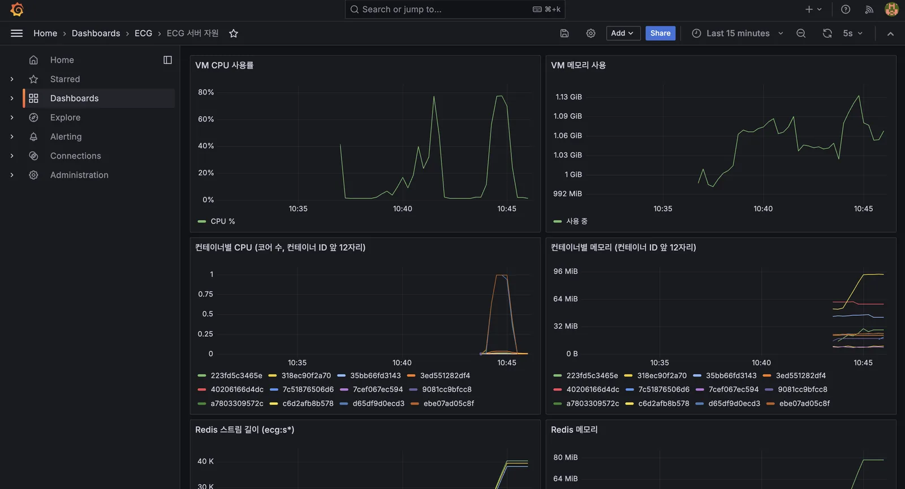
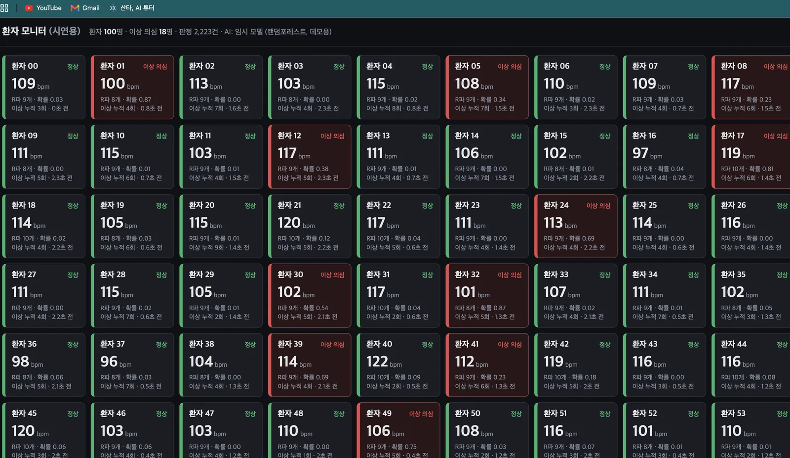
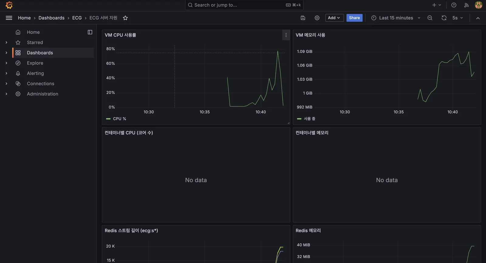

## 목표

테스트 서버(ecg VM)에서 환자 수를 6 → 20 → 50 → 100명으로 늘리며 끝단 지연과 유실을 재고, 서버가 어디서 버티지 못하는지 찾는다. 숫자를 눈으로 보려고 Prometheus·Grafana 모니터링을 붙인다. (10.13)

- 측정 도구 : 보내는 구간은 3단계 D의 측정용 수신기, 끝단은 워커 로그 (B 아래 측정 도구)

## A. 모니터링 붙이기

- 앱 코드는 안 건드리고 기존 도커 컴포즈 위에 얹는 방식
- Prometheus: 숫자를 5초마다 모아 저장하는 창고 (`:9090`)
- Grafana: 창고 숫자를 그래프로 보여주는 화면 (`:3000`)
- exporter: 숫자를 내보내는 체온계. node-exporter(VM CPU·메모리), cAdvisor(컨테이너별), redis-exporter(큐 길이)

```
node-exporter · cAdvisor · redis-exporter
        ↓ 5초마다 수집
   Prometheus (저장)
        ↓
   Grafana (대시보드 "ECG 서버 자원")
```

```bash
SHARDS=3 GRAFANA_PASSWORD=... \
  docker compose -f docker-compose.yml -f docker-compose.monitoring.yml up -d
```

```yaml
global:
  scrape_interval: 5s      # 부하테스트는 짧게 끝나서 5초 간격으로 모음

scrape_configs:
  - job_name: prometheus
    static_configs: [{ targets: ["localhost:9090"] }]
  - job_name: node
    static_configs: [{ targets: ["node-exporter:9100"] }]
  - job_name: cadvisor
    static_configs: [{ targets: ["cadvisor:8080"] }]
  - job_name: redis
    static_configs: [{ targets: ["redis-exporter:9121"] }]
  - job_name: patients
    static_configs: [{ targets: ["host.docker.internal:9101"] }]
```

- `monitoring/prometheus.yml` : 프로메테우스가 어디서 숫자를 가져올지 적은 목록
- `scrape_interval: 5s` : 5초마다 가져감
- `job_name` : 수집 대상 이름 / `targets` : 그 대상의 주소:포트
- `node-exporter:9100` : 같은 도커 네트워크 안이라 컨테이너 이름으로 찾아감
- `host.docker.internal:9101` : 환자 상태 화면(D)은 컨테이너 밖(VM)에서 돌아서 VM 쪽 주소로 붙음
- 프로메테우스가 각 주소의 `/metrics` 페이지를 직접 가져가는 방식. exporter가 보내주는 게 아님
- 접속은 Tailscale 내부망에서만. 공유기 포트는 열지 않음
- 캡처: 대시보드 전체



## B. 환자 수별 측정

- 조건: VM 4코어, 워커 3개, 워커는 메시지 1건에 3ms 일하는 척(가짜 분석), 각 30초
- 지연 = 워커 처리 끝난 시각 − 생성기가 보낸 시각 (2초마다 집계한 p95의 범위)

| 환자 수 | 보냄 | 유실 | w0 p95 | w1 p95 | w2 p95 |
| --- | --- | --- | --- | --- | --- |
| 6 | 1,800 | 0 | 12\~13ms | 12\~13ms | 11\~13ms |
| 20 | 6,000 | 0 | 25\~27ms | 25\~27ms | 22\~24ms |
| 50 | 15,000 | 0 | 52\~54ms | 52\~54ms | 51ms |
| 100 | 30,000 | 0 | **120ms → 1,010ms (계속 증가)** | 101\~110ms | 101\~110ms |
- 100명 60초 한 번 더: w0 p95 약 0.9초 → 1.9초까지 계속 늘어남. VM CPU 약 78%, 워커 컨테이너 1코어 가득

### 측정 도구 (10.13)

- 끝단 측정은 따로 스크립트를 만들지 않고 워커 로그로 봄. 워커가 2초마다 p95를 집계해서 출력 (워커는 서버 담당 팀원이 만듦)
    - 지연 = 워커 처리 끝 − sent_at
- 보내는 구간은 3단계 D의 측정용 수신기(`measure_recv.py`)로 잼
- 이후 서버 담당 팀원이 워커 수 × 환자 수 스윕 스크립트(`server/bench/`)를 추가함

## C. 100명에서 w0만 밀린 이유

- 환자를 `환자번호 % 3`으로 워커에 나눔 → 100명이면 w0 34명, w1·w2 33명
- w0: 34명 × 초당 10건 × 3ms = **1.02초** 분량 일을 1초에 해야 함 → 못 따라가서 큐에 쌓임
- w1·w2: 33명 → 0.99초 → 아슬아슬하게 버텨
- 워커 하나(1코어)당 한계는 약 33명
- 진짜 R파·AI가 붙으면 건당 시간이 늘어서 한계 인원은 더 줄어듦
- 개선 방향: 코어 많은 장비로 워커 늘리기, 묶어서 처리(배치), 건당 처리 시간 줄이기

### 후속 확인 (팀원 분석)

- 실제 판정은 메시지마다가 아니라 5초 창 단위. 처음 5초(메시지 50건)가 모이면 1번, 그 뒤로는 창을 1초씩 밀면서 1초마다 1번 (stride 1초)
    - stride : 창을 얼마씩 밀면서 다음 판정을 할지. 1초면 5초 창이 4초씩 겹치며 이동
- 실제 분석 1회(5초 창) 약 2.5ms → 환자 1명당 초당 약 2.5ms (1초에 1번)
- 3ms 가정은 환자 1명당 초당 30ms(10건 × 3ms) → 실제보다 약 12배 무거웠음
- 실제 1D-CNN을 붙여 다시 잰 100명 결과: 유실 0, 구간 판정 p95 약 102ms (맥북 기준)
- 위 표는 3ms/건 가정에서 워커 한계를 넘으면 큐가 계속 쌓인다는 걸 확인한 결과로 남겨둠
- 남은 것: ecg VM에서 실제 분석 기준으로 다시 측정

## D. 환자 상태 화면 (시연용)

- A의 모니터링은 서버 상태용. 이건 환자 판정 결과를 보는 화면
- 시연 워커가 9101 포트로 환자 그리드(정상 초록, 이상 의심 빨강, 판정 불가 회색, 10초 넘게 신호 없으면 흐리게)와 `/metrics`를 같이 내보냄
- Grafana "ECG 환자 상태 (시연)" 대시보드: 이상 의심 환자 수, 환자별 상태, 상태 기록 타임라인, 심박
- 100명 띄워서 그리드 확인
- 캡처: 환자 그리드(빨간 카드 있을 때), Grafana 상태 타임라인



## 트러블슈팅

### 컨테이너별 그래프만 No data

- 증상: VM CPU·Redis 그래프는 나오는데 컨테이너별 CPU·메모리만 비어 있음
- 확인: cAdvisor 로그에 `failed to identify the read-write layer ID ... mount-id: no such file or directory`
- 원인: VM의 Docker 29가 이미지 저장 방식을 containerd로 바꿔서 예전 경로가 없음. cAdvisor의 Docker 연동이 컨테이너를 통째로 건너뜀
- 해결: cAdvisor에 Docker 소켓을 안 보여주고 리눅스 cgroup(커널이 컨테이너별 자원 사용을 세는 곳, `docker-<ID>.scope`)을 직접 읽게 바꿈. 범례는 컨테이너 ID 앞 12자리라 `container_names.sh`로 이름 대조

```yaml
cadvisor:
  image: gcr.io/cadvisor/cadvisor:v0.49.1
  container_name: ecg-cadvisor
  privileged: true
  devices: ["/dev/kmsg"]
  volumes:
    - /sys:/sys:ro
    - /dev/disk/:/dev/disk:ro
  restart: unless-stopped
```

- `docker-compose.monitoring.yml`의 cAdvisor 부분
- 보통 예제는 `volumes`에 `/var/run/docker.sock`(Docker 소켓)을 붙여서 Docker에게 컨테이너 정보를 물어봄. 그게 Docker 29에서 실패해서 일부러 뺌
- `/sys:/sys:ro` : 리눅스가 cgroup별 자원 사용량을 적어두는 곳. 소켓 없이 여기서 바로 읽음. `ro`는 읽기 전용
- `privileged: true` : 시스템 정보를 읽을 권한
- 다른 방법: Docker 저장 방식을 예전(overlay2)으로 되돌리기. 이미지·컨테이너를 다시 받아야 해서 팀 서버에선 보류
- 캡처: 고치기 전 No data / cAdvisor 에러 로그 / 고친 뒤



### 적체·중복 숫자가 실제와 다름

- 증상: 100명 측정이 끝났는데 적체가 52,800으로 계속 늘어남. 유실은 0인데 중복이 27,800건
- 확인: 워커 로그상 실제 처리는 다 끝나 있었음. 적체는 전송량만큼, 중복은 두 번째 실행 분량만큼 늘어남
- 원인 1 (적체): 큐 하나를 제품 워커(`cg` 그룹)와 시연 워커(`demo` 그룹)가 따로 읽는데, 수신부가 두 그룹의 안 읽은 메시지를 합쳐서 셈. 시연 워커가 꺼져 있으면 그쪽 미처리분이 전부 적체로 잡힘
    - 같은 신문을 두 집이 구독하는데, 한 집이 안 읽은 신문까지 "배달 밀림"으로 센 것
- 원인 2 (중복): 생성기를 다시 돌리면 메시지 번호(seq)가 0부터 새로 시작. 수신부는 "번호가 1000 넘게 뒤로 가면 재시작"으로 판단했는데, 30초 실행은 번호가 300까지만 올라가서 재시작으로 안 보고 두 번째 실행 전체를 중복으로 셈
- 해결
    - 적체를 그룹별로 나눠 세고, 운영에서 보는 적체는 제품 워커(`cg`)만
    - 번호가 0으로 돌아오면 재시작으로 보고 재시작 횟수를 따로 셈
    - 단위 테스트 7개 추가. 일부러 `demo` 그룹을 안 읽게 두고 두 번 돌려서 적체 0, 중복 0, 재시작 10 확인
- 같이 발견: 테스트 서버에 고치기 전 수신부가 계속 떠 있었음. 코드 수정과 서버 반영은 별개라 교체 후 다시 확인해야 함
- 재측정: 팀원 맥북에서 수정본으로 6·20·50·100명을 이어서 돌렸을 때 유실 0, 중복 0, 재시작 76 (= 0 + 6 + 20 + 50. 생성기를 다시 돌릴 때마다 앞 단계 환자 수만큼 seq가 0으로 돌아옴). ecg VM 반영 후 재측정은 아직

### 100명 심박이 다 비슷함

- 증상: 환자 그리드에서 100명 심박이 거의 다 100\~120
- 원인: 생성기가 100명 모두 같은 기록(s30661) 1분을 시작 위치만 다르게 보냄. 이상 의심도 환자 차이가 아니라 같은 파형의 다른 구간을 본 것
- 해결: 생성기에 `--records auto` 옵션 추가 (팀원 작성, PR 검토 중). 기본 동작은 그대로 두고, 옵션을 주면 환자마다 다른 3리드 기록을 보냄. 심박 범위 100\~120 → 65\~120
    - 기록 18개를 미리 받아둬야 함 (약 4분). 시연 중에 받으면 그 시간이 지연으로 잡힘

## 남은 작업

- [x]  6 → 20 → 50 → 100명 끝단 지연 측정 (가짜 분석 3ms 기준)
- [x]  Prometheus·Grafana 모니터링
- [x]  환자 상태 화면 (시연용)
- [ ]  적체·중복 수정본 서버 반영 후 재측정
- [ ]  진짜 R파·AI 붙인 뒤 다시 측정
- [ ]  생성기 환자별 기록 다양화
