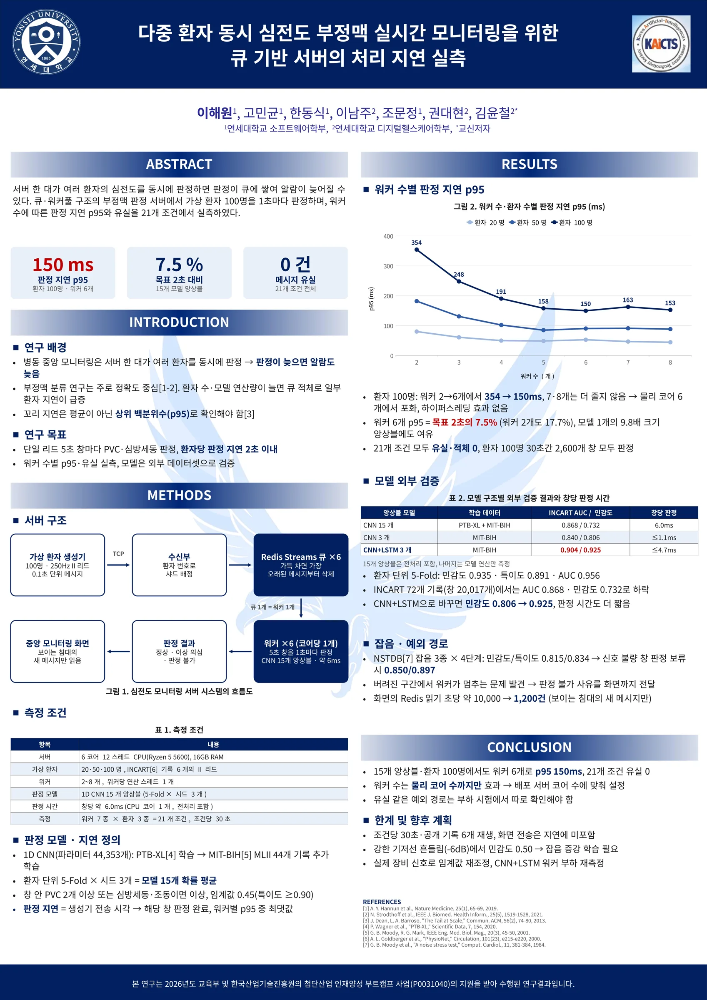

## 개요

**2026 한국인공지능융합기술학회 추계학술대회 우수 발표 논문상**

산학 프로젝트 [실시간 심전도 처리 서버](/projects/sanhak-ecg/)의 결과를 정리한 논문입니다. 공개 데이터(PhysioNet)만 사용했습니다.

논문 제목: 「다중 환자 동시 심전도 부정맥 실시간 모니터링을 위한 큐 기반 서버의 처리 지연 실측」

<!-- 원문(PDF·hwp)은 올리지 않음. 포스터만 공개 -->
